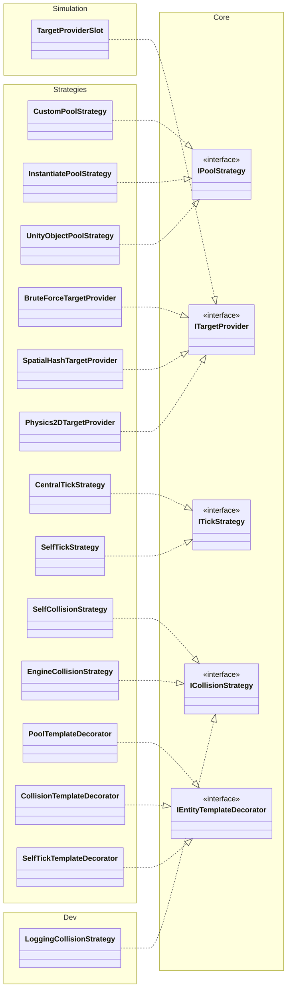
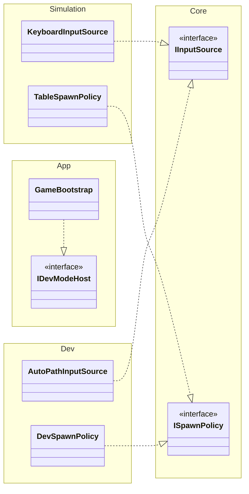
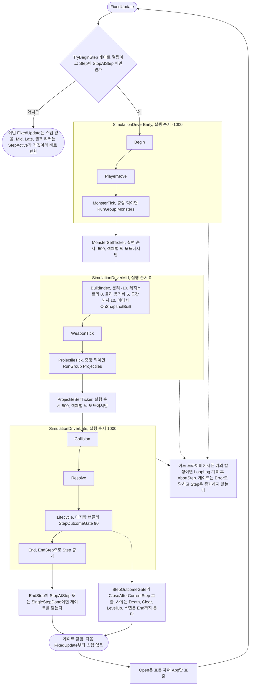

# Survivor

Unity 2D 뱀파이어 서바이버라이크. 풀링·타깃 탐색·Update 집중화·충돌 판정을 전략 인터페이스 뒤로 분리하고, 어느 조합을 골라도 같은 결과가 나오는 고정 스텝 위에서 비용 차이만 재는 것이 이 프로젝트의 핵심이다.

<!-- GIF: 사용자가 넣는다 (시연 GIF 1개, F13) -->

- 시연 영상(1~2분): <!-- TODO(사용자): YouTube 링크(공개) -->
- 빌드 다운로드(Windows zip): <!-- TODO(사용자): GitHub Releases 링크 -->
- 기준 버전: Unity 6000.3.28f1 (Universal 2D). 이 문서의 코드 설명은 커밋 `93b089e` 기준이다.

## 실행 방법

**지원 환경**: Windows 10/11 64비트. 모니터 작업 영역 1280x720 이상이 필요하다. 이보다 작으면 창이 잘릴 수 있다.

1. Releases의 zip을 받아 **반드시 압축을 풀고** 실행한다. zip 안에서 바로 실행하면 `StreamingAssets`가 없어 데이터 로드에 실패한다.
2. Windows SmartScreen 경고가 뜰 수 있다. 경고가 뜨면 "추가 정보"에서 실행을 선택한다. <!-- TODO(사용자): 실제 빌드에서 뜨는 경고 문구와 실행 절차 확인 -->
3. 타이틀 화면에서 시작해 사망 또는 클리어까지 한 판을 즐긴다.

**조작**: 이동은 WASD 또는 방향키. 레벨업 선택은 키보드 1/2/3 또는 마우스 클릭. ESC는 일시정지. 창이 포커스를 잃으면 자동으로 일시정지한다.

**빌드 3종의 뜻**

| 빌드 | 용도 | 개발자 모드 |
|---|---|---|
| 릴리스 | 배포용 (GitHub Releases에 올린다) | 포함. 실행 인자 `--dev` 없이는 켜지지 않는다 |
| Development | 측정용 (Profiler 연결 가능) | 포함. `--dev`로 켠다 |
| `SURVIVOR_NO_DEV` | 개발자 모드 코드를 제거한 비교용. **배포하지 않는다** | 코드 자체가 없다 |

릴리스와 Development의 차이는 Development Build 플래그(Profiler 연결 가능 여부)뿐이다. `SURVIVOR_NO_DEV` 빌드는 "개발자 모드가 꺼져 있으면 동일 동작"을 코드 부재가 아니라 측정(인자 없는 릴리스 빌드 대 이 빌드의 Profiler 비교)으로 보이기 위한 것이다.

**에디터에서 열기**: Unity 6000.3.28f1로 `Survivor/` 폴더를 연다. 씬은 `Survivor/Assets/Scenes/Main.unity`다.

## 아키텍처

어셈블리는 `Survivor.Core`, `Survivor.Data`, `Survivor.Simulation`, `Survivor.Strategies`, `Survivor.UI`, `Survivor.App`, `Survivor.Dev`, `Survivor.Editor`와 테스트 3개(`Survivor.Tests.EditMode`, `Survivor.Tests.PlayMode`, `Survivor.Tests.Dev`)다. 참조 방향은 asmdef 기준으로 다음과 같다.

- `Core`는 아무것도 참조하지 않는다. `Data`는 `Core`만 참조한다.
- `Simulation`은 `Core`·`Data`만 참조한다. `Strategies`는 `Core`만 참조한다. 둘은 서로를 참조하지 않고, 필요한 연결은 `Core`의 인터페이스로 한다.
- `UI`는 `Core`·`Data`·`Simulation`을, `App`은 `Core`·`Data`·`Simulation`·`Strategies`·`UI`를 참조한다. `App`이 조립 루트(`GameBootstrap`)다.
- `Dev`는 `App`을 참조해 스스로 붙는다. `Dev`를 참조하는 것은 `Tests.Dev`뿐이고, `!SURVIVOR_NO_DEV` 제약이 걸려 있다.

### 다이어그램 1. 인터페이스와 구현 클래스

인터페이스 17개와 그 구현 클래스 47개다. 멤버는 그리지 않았다. 한 그림에 담기엔 커서 세 그림으로 나눴다(인터페이스 5+9+3 = 17개, 구현 15+27+5 = 47개, 실현선 15+34+5 = 54개). 한 인터페이스는 한 그림에만 나온다. `Data`·`UI`·`Editor` 어셈블리에는 인터페이스 구현이 없어 그림에 나오지 않는다. 점선 화살표는 "구현한다"이다.

코드 기준 커밋 93b089e

#### 1-① 전략 네 축과 템플릿 데코레이터

풀·타깃·틱·충돌 네 축의 인터페이스와 구현, 그리고 엔티티 템플릿 데코레이터다. 인터페이스 5개 / 구현 15개.

#### 1-② 시뮬레이션 루프·엔티티

스텝 단계 처리기, 갱신 대상, 명령 버퍼와 명령 처리기, 충돌 이벤트 처리기, 피해 인터페이스와 그 구현이다. 물리 바디 등록 인터페이스(`IPhysicsBodyRegistry`)는 `PhysicsBodySynchronizer`가 `IStepPhaseHandler`도 함께 구현하므로 한 그림에 두려고 여기에 넣었다. 인터페이스 9개 / 구현 27개.

```mermaid
classDiagram
    direction LR

    namespace Core {
        class IUpdatable
        class ISimulationCommands
        class IStepPhaseHandler
        class IStepClockReader
        class IPhysicsBodyRegistry
        class IDamageable
        class IContactDamageSource
    }

    namespace Simulation {
        class ISimulationCommandHandler
        class ICollisionEventHandler
        class Monster
        class PlayerProjectile
        class EnemyProjectile
        class EnemyHazardZone
        class SimulationCommandBuffer
        class SimulationClock
        class EntityDespawnCommandHandler
        class PlayerSpawnCommandHandler
        class MonsterCommandHandler
        class DropCommandHandler
        class PlayerHitHandler
        class PlayerDamageReceiver
        class PickupSystem
        class PendingCommandQueue
        class PlayerMovement
        class MonsterRegistry
        class WeaponInventory
        class CollisionEventRouter
        class WeaponDamageResolver
        class KillPipeline
        class LifetimeSystem
        class DespawnSystem
        class MonsterSpawner
        class StepOutcomeGate
        class MonsterSeparation
    }

    namespace Strategies {
        class PhysicsBodySynchronizer
        class MonsterSpatialIndex
    }

    <<interface>> IUpdatable
    <<interface>> ISimulationCommands
    <<interface>> IStepPhaseHandler
    <<interface>> IStepClockReader
    <<interface>> IPhysicsBodyRegistry
    <<interface>> IDamageable
    <<interface>> IContactDamageSource
    <<interface>> ISimulationCommandHandler
    <<interface>> ICollisionEventHandler

    Monster ..|> IUpdatable
    PlayerProjectile ..|> IUpdatable
    EnemyProjectile ..|> IUpdatable

    SimulationCommandBuffer ..|> ISimulationCommands

    SimulationClock ..|> IStepClockReader

    PhysicsBodySynchronizer ..|> IPhysicsBodyRegistry

    Monster ..|> IDamageable

    Monster ..|> IContactDamageSource
    EnemyProjectile ..|> IContactDamageSource
    EnemyHazardZone ..|> IContactDamageSource

    EntityDespawnCommandHandler ..|> ISimulationCommandHandler
    PlayerSpawnCommandHandler ..|> ISimulationCommandHandler
    MonsterCommandHandler ..|> ISimulationCommandHandler
    DropCommandHandler ..|> ISimulationCommandHandler

    PlayerHitHandler ..|> ICollisionEventHandler
    PlayerDamageReceiver ..|> ICollisionEventHandler
    PickupSystem ..|> ICollisionEventHandler

    PendingCommandQueue ..|> IStepPhaseHandler
    PlayerMovement ..|> IStepPhaseHandler
    MonsterRegistry ..|> IStepPhaseHandler
    WeaponInventory ..|> IStepPhaseHandler
    PickupSystem ..|> IStepPhaseHandler
    CollisionEventRouter ..|> IStepPhaseHandler
    WeaponDamageResolver ..|> IStepPhaseHandler
    PlayerDamageReceiver ..|> IStepPhaseHandler
    KillPipeline ..|> IStepPhaseHandler
    SimulationCommandBuffer ..|> IStepPhaseHandler
    LifetimeSystem ..|> IStepPhaseHandler
    DespawnSystem ..|> IStepPhaseHandler
    MonsterSpawner ..|> IStepPhaseHandler
    StepOutcomeGate ..|> IStepPhaseHandler
    MonsterSeparation ..|> IStepPhaseHandler
    PhysicsBodySynchronizer ..|> IStepPhaseHandler
    MonsterSpatialIndex ..|> IStepPhaseHandler
```

#### 1-③ 입력·스폰·앱

입력원, 스폰 정책, 개발자 모드 호스트와 그 구현이다. 인터페이스 3개 / 구현 5개.

`Core`의 인터페이스는 14개, `Simulation`의 것은 `ISimulationCommandHandler`·`ICollisionEventHandler` 2개, `App`의 것은 `IDevModeHost` 1개다. 네 가지 전략 축(풀, 타깃, 틱, 충돌)은 각각 `IPoolStrategy`, `ITargetProvider`, `ITickStrategy`, `ICollisionStrategy`이고, 구현은 `Strategies`에 있다. `TargetProviderSlot`은 현재 타깃 공급자에게 위임하는 슬롯이고, `LoggingCollisionStrategy`는 충돌 전략을 감싸는 `Dev`의 데코레이터다.

### 다이어그램 2. 고정 스텝 한 스텝의 흐름

게임 시간의 유일한 원천은 `SimulationClock.Step`이다. 1스텝은 1/60초이고, 한 스텝은 `FixedUpdate` 한 번 안에서 실행 순서가 다른 드라이버 3개가 `SimulationPhase` 10단계를 나눠 돌린다. 객체별 틱 모드에서는 드라이버 사이에 셀프 티커가 끼어든다. 프레임당 catch-up은 최대 3스텝이다.

코드 기준 커밋 93b089e

단계 핸들러는 (단계, 순서값)으로 `SimulationPipeline`에 등록하고, 같은 순서값을 두 번 쓰면 예외다. 그래서 전략 조합이 달라도 실행 순서가 같다. 흐름도의 단계 노드는 `SimulationPhase`의 10개(`Begin`, `PlayerMove`, `MonsterTick`, `BuildIndex`, `WeaponTick`, `ProjectileTick`, `Collision`, `Resolve`, `Lifecycle`, `End`)와 1:1이다.

## 설계 이유

### 왜 전략 인터페이스로 분리했는가

이 프로젝트가 만들려는 것은 기능의 양이 아니라 **측정 가능한 구조**다. 풀링, 타깃 탐색, Update 집중화, 충돌 판정은 서로 다른 병목이고, 각각 "끔(기준선)"과 "켬(직접 구현)"을 같은 게임 안에서 바꿔 가며 비용만 비교하려면 네 축이 인터페이스 뒤에서 교체 가능해야 한다. 전략 종류는 `PoolStrategyKind`, `TargetProviderKind`, `TickStrategyKind`, `CollisionStrategyKind`(충돌은 엔진 쪽에 `CollisionDetectionMode2D`가 더 붙는다) 네 열거형이고, 한 판의 조합은 `StrategySelection`(Core)이 들며 `StrategyFactory.Create`(App)가 만든다. 풀 3 x 타깃 3 x 틱 2 x 충돌 2 = 36조합이다.

교체해도 결과가 같아야 비교가 공정하다. 그래서 게임 시간은 1/60초 고정 스텝으로 세고, 객체 ID·정렬·타이브레이크·RNG를 모두 결정론으로 묶었다. 36조합 전부에서 상태 해시가 같은 값(`0x9CCD040879EF6EE7`)으로 일치하는 것을 PlayMode 테스트로 확인한다(93b089e 기준). 측정 설계(F10)는 이 네 축에 맞춰 짰다. A0은 기준선(전부 끔)으로 적 수를 올려 평균 FPS 55 미만이 되는 N*를 찾고, A는 N*에서 전략을 하나씩 켜는 6회(전부 끔, 풀·타깃·틱·충돌 단독, 전부 켬)로 단독 기여와 상호작용을 보며, B는 적 50/100/200/400 x {전수 순회, 공간 분할} 8회로 곡선과 교차점을 보고, C는 엔진 대안(Unity 내장 풀, `Physics2D` 쿼리) 2회로 내 구현 대 엔진 제공을 비교한다. 전략 비교가 단순한 "켜기/끄기"가 아닌 것은 타깃 탐색의 공간 해시를 자체 충돌 판정이 후보 추림에 다시 쓰기 때문이다. 둘이 `MonsterSpatialIndex` 하나를 공유하므로 "전부 켬"에서 유지 비용이 한 번만 든다.

근거: DECISIONS 2절 "Q15 전략 비교 6회", 1절 "고정 타임스텝 채택", TECH 5.0.1·5.3·5.7·5.9.

### 왜 JSON을 선택했는가

게임 데이터 7종(무기, 몬스터, 조합 규칙, 스폰 테이블, 패시브, 레벨업 선택지 풀, 플레이어 기본 스탯)을 `StreamingAssets/Data/`의 JSON으로 둔다. 빌드 폴더에 원본 파일이 그대로 복사되므로 **빌드된 게임에서 데이터 파일만 편집해 무기·몬스터를 추가**하는 시연이 가능하다. ScriptableObject는 에디터에서 프리팹·스프라이트를 직접 참조로 물릴 수 있어 이 요구를 더 깔끔히 만족하지만 빌드 후 편집이 불가능해 채택하지 않았다(`docs/devlog.md` "검토했으나 채택하지 않은 대안"). 대가로 파서 연동, 에셋 키 레지스트리, 스키마 검증을 직접 만든다. JSON은 프리팹·스프라이트를 가리킬 수 없으므로 문자열 키(`assetKey`)로 간접 참조하고, 키를 실제 에셋으로 해석하는 레지스트리(`Resources/AssetKeyRegistry.asset`)를 둔다. 등록되지 않은 키는 마젠타 원으로 대체되고 경고가 남는다.

파싱은 Newtonsoft(`com.unity.nuget.newtonsoft-json`)가 맡고, 필드 바인딩과 검증은 직접 작성했다. 파일은 UTF-8이어야 한다. 필수 4종(무기, 몬스터, 스폰 테이블, 플레이어 기본 스탯)이 깨지면 시작을 차단하고 원인을 화면에 표시한다. 선택 3종(조합 규칙, 패시브, 레벨업 선택지 풀)은 경고 후 계속한다. 정의 하나가 틀리면 그 정의만 건너뛰고 경고하며, 알 수 없는 키는 경고 후 무시한다. 플레이어 기본 스탯은 오류면 기본값으로 때우지 않고 차단한다. 기본값으로 대체하면 밸런싱과 측정이 조용히 거짓이 되기 때문이다.

근거: DECISIONS 8절 "PRD#21 데이터 형식", "Q17 JSON 위치", "D17 JSON 파서", "Q18 정의 단위 검증 실패", TECH 5.11·5.13.

### 왜 개발자 모드를 별도 어셈블리로 뒀는가

개발자 모드(F19)는 같은 게임 씬에서 측정·디버깅·JSON 핫 리로드 시연을 하는 도구다. 게임 로직 안에 `if (devMode)` 분기가 흩어지면 최소 수정 원칙이 깨지고 그 분기 비용이 측정 수치에 섞인다. 그래서 개발자 도구는 게임 코드에 침투하지 않고, 게임 쪽은 값을 주입받는 형태로 만들었다. 예컨대 플레이어 자동 경로는 `IInputSource` 구현 교체(`AutoPathInputSource`), 측정용 스폰은 `ISpawnPolicy` 교체(`DevSpawnPolicy`), 충돌 로그는 `ICollisionStrategy` 데코레이터(`LoggingCollisionStrategy`)다.

의존 방향을 뒤집어 `Dev`가 `App`을 참조해 스스로 붙게 했고, 게임 어셈블리 어느 것도 `Dev`를 참조하지 않는다. 그래서 `if (devMode)` 금지가 컴파일러 수준에서 강제되고, `Survivor.Dev`에 걸린 `defineConstraints`(`!SURVIVOR_NO_DEV`)만으로 개발자 모드 코드를 제거한 빌드가 별도 수정 없이 나온다. 릴리스 빌드에도 포함하고 `--dev` 인자로 켜는 것은 배포 빌드 하나로 플레이·측정·핫 리로드 시연을 모두 하기 위해서다. 비활성 상태에서는 시작 시 인자 확인 1회 외에 어떤 분기도, 키 감시도 없다. 코드 제거 빌드와의 동일 동작은 측정(인자 없는 릴리스 빌드 대 `SURVIVOR_NO_DEV` 빌드의 Profiler 비교 1회)으로 보인다.

근거: DECISIONS 9절 "개발자 도구는 게임 코드에 침투하지 않는다", "D31 개발자 어셈블리 의존 방향", "Q40 개발자 모드 활성화와 릴리스 포함", "코드 제거 빌드 비교".

### 게임플레이 기능별 설계 이유 (F1~F8)

**F1 플레이어 이동·카메라.** 이동은 `PlayerMovement`가 고정 스텝에서 하고, 입력은 키보드를 직접 읽지 않고 `IInputSource`를 거친다(기본 `KeyboardInputSource`, 개발자 모드는 `AutoPathInputSource`). 덕분에 측정에서 플레이어를 원형 경로로 돌려 적이 한 점에 쌓이지 않게 할 수 있다. 입력은 키보드(WASD/방향키)만 지원하고 게임패드는 범위에서 뺐다. 맵은 경계 없는 무한 평면이고 카메라는 플레이어에 즉시 스냅한다. 카메라 orthographic size는 9로, 16:9에서 화면 반대각의 절반(약 18.4)이 스폰 반경(20)보다 작아 적이 화면 안에서 생기지 않는다. 근거: DECISIONS 3절 "입력 방식", 5절 "맵 구조", 7절 "카메라 즉시 스냅", 7절 "Q44 카메라 크기", TECH 5.5.

**F2 무기 자동 공격.** 무기는 4종이며 각각 측정 축의 부하원과 1:1로 이어진다. W1 투사체와 W4 유도 투사체는 타깃 탐색의 소비자, W2 궤도 근접은 충돌 판정의 주 소비자이고, W3는 장판이다. "가장 가까운 적" 질의는 `ITargetProvider` 뒤로 분리했고(몬스터는 이 질의를 쓰지 않고 플레이어 위치를 직접 읽는다), 쿨다운은 실수 시간이 아니라 스텝 번호로 센다. 시작 무기는 W1이다. 무기 없이 시작하면 적을 못 죽여 첫 레벨업이 불가능한 진행 불가 상태가 되기 때문이다. 투사체는 수명이 끝나면 소멸하고 사거리는 수명으로 대체했다. 근거: DECISIONS 3절 "무기 4종 구성", "Q7 시작 무기", "Q9 투사체 수명·사거리", 1절 "쿨다운·무적은 스텝 번호로 센다", TECH 5.7.

**F3 몬스터·스폰·분리.** 몬스터는 M1 좀비(물량), M2 돌진체, M3 원거리, M4 보스(10분에 등장)의 4종이고, 스폰은 구간별로 늘어나 0~2분 M1 초당 2기에서 시작해 8~10분 전종 초당 10기까지 간 뒤 10분에 스폰을 멈추고 보스가 나온다. 동시 존재 상한은 400이며 이 400 자체가 타깃 탐색 실험의 측정 대상이다. 스폰은 화면 밖 원주(반지름 20)에서 하고, 멀어진 적은 디스폰 거리 D=45에서 지워 무한 평면의 "경계" 역할을 맡긴다. 구간별 체력 배율(JSON `hpMultiplier`)은 스폰 시점에 곱해 이미 살아 있는 몬스터는 바뀌지 않는다. 몬스터는 플레이어와 접촉 거리까지만 다가오고(접촉 멈춤), 몬스터끼리는 매 스텝 분리 패스 1회로 겹침을 푼다. 분리 패스는 `MonsterTick`이 아니라 `BuildIndex` 순서 -10에 두었다. `MonsterTick` 핸들러는 객체별 틱 전략의 이동보다 먼저 돌아 틱 전략에 따라 입력 위치가 달라지기 때문이다. 보스는 소환 패턴만 남기고 광역 장판 패턴은 데이터에서 뺐다(스키마와 판정 코드는 남겨 JSON으로 다시 켤 수 있다). 근거: DECISIONS 5절 "몬스터 4종", "스폰 곡선과 동시 존재 상한 400", "맵 구조", "Q37 디스폰 거리", "몬스터 체력의 시간 증가", "첫 Play 피드백: 몬스터 규칙 3건", TECH 5.12.1.

**F4 젬·상자·자석.** 몬스터는 경험치 젬을 떨어뜨리고, 낮은 확률(2%)로 상자를 떨어뜨린다. 젬과 상자를 획득하는 판정도 다른 충돌과 같은 원-원 판정 함수와 `ICollisionEventHandler`(`PickupSystem`) 경로를 쓴다. 획득 범위는 패시브(획득범위)로 늘어난다. 상자 효과는 진화 조건을 충족한 무기가 있으면 진화가 최우선(확정)이고, 없으면 강화 70%·회복 30%다. 강화 후보는 5단계 미만 무기와 최대 단계 미만 패시브를 한 풀로 섞어 균등하게 뽑으며, 후보가 없으면 회복으로 대체한다. 젬·상자에는 디스폰 규칙을 두지 않았다. 규칙을 미리 넣지 않고 측정 때 활성 젬 수를 기록해 문제가 되는지 확인하기로 했다. 근거: DECISIONS 6절 "드랍 구성", "Q5 상자", "D3 젬·상자 디스폰 규칙", "상자 보상에 패시브 추가", TECH 5.12·5.14.

**F5 레벨업.** 레벨업 선택지는 항상 3칸이고 가중치 랜덤이다. 무기는 최대 4개, 패시브는 최대 3개, 각각 5단계이며 리롤은 없다. 회복은 일반 후보 풀에 들어가되 가중치가 체력 비율 r에 반비례하는 `w_base x (1 - r)^2`라서 체력이 높으면 거의 나오지 않고 낮을수록 구제 역할을 한다(만체력이면 후보에서 제외). 선택은 스텝 게이트 밖에서 즉시 적용한 뒤 연속 레벨업을 다시 평가하고, 선택 입력은 회차당 첫 입력만 받는다. 후보가 수십 개 수준이라 가중치 뽑기는 누적 합 배열 재계산으로 충분하고 펜윅 트리는 과하다고 판단했다. 근거: DECISIONS 6절 "레벨업 선택지 규칙", "Q6 선택지 칸 수와 회복량", "Q29 회복 선택지 처리", "레벨업 선택 적용·연속 레벨업·입력 규칙", TECH 5.14.

**F6 피해·충돌 판정·탄 통과.** 충돌은 `ICollisionStrategy.CollectEvents()`가 이번 스텝의 이벤트 목록을 반환하는 폴링으로 통일해, 엔진판이든 자체판이든 피해 적용 로직이 하나로 유지된다. 피해는 세 갈래다. 투사체·젬·상자는 일회성 접촉(Enter 1회 처리, 관통 시 이미 맞힌 ID 목록), 궤도·장판은 공격자 측 쌍별 쿨다운, 적에서 플레이어로는 피격자 측 공통 무적이다(쌍별로 하면 400기 겹침에 즉사한다). 쿨다운과 무적은 스텝 번호로 센다. 같은 스텝에 이미 죽은 몬스터에 닿은 탄은 소모되지 않고 통과한다. 이는 플레이 중 "탄이 낭비된다"는 체감 문제에서 나온 규칙이다. 터널링은 런타임 보정이 아니라 JSON 로드 때 객체별 불변식 `v/60 <= r`(어떤 객체도 한 스텝에 자기 반지름보다 멀리 가지 않는다)로 검증해 위반 시 경고한다. 근거: DECISIONS 4절 "충돌 전략은 폴링으로 통일", "피해 틱 3분류", "Q35 터널링 처리", "같은 스텝에 이미 죽은 몬스터에 닿은 뒤 탄은 소모되지 않는다", TECH 5.9·5.12.

**F7 패시브·진화.** 패시브는 공격속도·이동속도·획득범위 3종이고 각각 5단계다. 진화는 2종이다. W1 + 공격속도가 연사 투사체, W2 + 획득범위가 확대 궤도로 바뀌며, 조건은 무기 5단계와 해당 패시브 보유다. 진화는 조건을 채운 뒤 **상자를 획득할 때** 일어난다. 처음에는 자동 진화였지만, 적 수백 마리와 투사체가 깔린 화면에서 조용히 일어나 플레이어가 눈치채지 못할 수 있고, 상자 경유가 진화에 "획득 순간"을 만들어 시연 영상에서 조합 시스템을 보일 장면이 되기 때문에 바꿨다. 진화는 원본 무기를 교체하고 슬롯을 유지한다. 조합 규칙은 JSON(`combinations.json`)이라 새 조합을 코드 수정 없이 추가할 수 있다. 근거: DECISIONS 3절 "패시브 3종", 6절 "조합(진화) 2종", "Q10 진화 발동 방식", "Q30 진화 무기 강화", TECH 5.14.

**F8 판의 흐름·HUD·창.** 화면 흐름은 타이틀, 플레이, 결과(생존 시간·처치 수·레벨·최고 기록), 재시작 또는 타이틀이다. ESC는 일시정지이고 설정 메뉴는 없다. 세이브는 없고 최고 생존 시간 1개만 로컬에 저장한다. 같은 스텝에 겹치면 사망, 클리어, 레벨업 순으로 우선하며, 스텝 게이트는 `Update`가 아니라 Lifecycle 핸들러(`StepOutcomeGate`)가 스텝 안에서 닫는다(`Update`에서 닫으면 프레임레이트 결정론이 무너진다). 창 포커스를 잃으면 자동 일시정지한다. 플레이어가 보는 화면(타이틀·레벨업·일시정지·결과·HUD)은 uGUI + CanvasScaler + TMP로 만들었다. 화면이 5개 안팎, 요소가 20개 수준이라 UI Toolkit의 장점이 발휘될 대상이 없었다. HUD 왼쪽 아래에는 보유 무기·패시브의 이름과 레벨, 현재 구간의 몬스터 체력 배율을 텍스트로 보인다. 창은 모니터 작업 영역에 들어가는 가장 큰 16:9 해상도(1920x1080, 1600x900, 1280x720 순)를 자동으로 고르는 창 모드다. 근거: DECISIONS 7절 "화면 흐름", "세이브 없음, 최고 생존 시간만 저장", "같은 스텝 겹침 우선순위", "D25 UI 기술", "Q24 해상도·창 정책", "HUD에 보유 무기·패시브 레벨 표시", 1절 "스텝 게이트는 Lifecycle 핸들러가 스텝 안에서 닫는다", TECH 5.17·5.18.

## "코드 수정 없이 추가 가능"의 경계

**JSON만으로 되는 것**: 기존 행동 타입의 파라미터와 조합이다. 무기 행동 타입은 `projectile`, `homing`, `orbit`, `zone`이고 몬스터 행동 타입은 `chaser`, `charger`, `ranged`, `boss`다. 이 범위에서 새 무기·새 몬스터·새 스폰 구간·새 조합 규칙·패시브 수치·레벨업 가중치·플레이어 기본 스탯은 전부 JSON 편집만으로 바뀐다. 예를 들어 "체력 300, 속도 2, 직선 추적형" 몬스터를 추가하는 것은 JSON만으로 된다.

**코드가 필요한 것**: 새 행동 타입이다. 예를 들면 플레이어를 포위하는 AI, 벽에 튕기는 투사체다. 그 이상을 데이터로 하려면 스크립팅 엔진을 만드는 일이 되어 범위 밖으로 그었다. 경계를 알고 그었다는 것이 설계의 일부다.

근거: DECISIONS 8절 "Q16 코드 수정 없이 추가의 범위", SPEC F11.

### F11 시연 절차 (빌드된 게임에서 JSON만 편집)

1. 빌드 폴더의 `<게임>_Data/StreamingAssets/Data/monsters.json`에 기존 행동 타입의 새 몬스터를 하나 넣는다. 예: `{ "id": "M5", "displayName": "거인 좀비", "behavior": "chaser", "assetKey": "shape.monster.green", "maxHealth": 300, "moveSpeed": 2, "radius": 0.6, "contactDamage": 10 }`
2. 같은 폴더의 `spawnTable.json`에서 원하는 구간의 `entries`에 `{ "monsterId": "M5", "weight": 1 }`을 넣는다.
3. (선택) `weapons.json`에 `projectile` 행동의 새 무기를 넣는다. `levels`는 정확히 5단계여야 한다.
4. 게임을 다시 실행한다. 로그의 첫 로드 줄에 데이터 로드 완료 메시지(7개 파일 중 7개, 몬스터 5)가 나오는지 확인한 뒤, 해당 시간대에 M5가 등장하는지, 새 무기가 선택지에 뜨는지 본다. <!-- TODO(사용자): 로그 줄의 실제 문구와 Player.log 위치를 시연 때 확인해 적는다 (2026-11-06 초안의 문구 "[Data] 데이터 로드 완료: 파일 7/7, ... 몬스터 5"는 현재 코드와 대조하지 않았다) -->
5. 실패 사례도 함께 시연한다. 필수 필드를 하나 지우면 그 정의만 빠지고 경고가 남는다. 중괄호를 하나 지워 필수 파일의 문법을 깨면 시작 차단 화면이 나온다.

`assetKey`가 레지스트리에 없으면 마젠타 원으로 표시되고 키 이름이 담긴 경고가 남는다.

시연 결과 기록: <!-- TODO(사용자): 시연 결과를 docs/devlog.md "F11 시연 기록"에 적는다 -->

## 개발자 모드 사용법

**켜기**

- 빌드: 실행 인자 `--dev`를 준다(대소문자 구분 없음). 예: `Survivor.exe --dev`
- 에디터: 메뉴 **Survivor > Dev Mode On Play**를 체크하고 Play한다. `--dev`를 준 것과 같다.
- 켜진 상태에서 **F1**로 오버레이를 토글한다. 인자가 없으면 아무것도 붙지 않는다.

오버레이 문구는 영어이고, 탭은 Run, Player, Enemies, Time, Strategy, Visual, Data 7개다.

| 탭 | 하는 일 |
|---|---|
| Run | 새 판 시작(타이틀·결과·일시정지에서), 시드 고정·무작위, 자동 경로(반지름·속도), 레벨업 켜기·끄기(Level-up enabled), 몬스터 400기 상한 해제 등 |
| Player | 무기·패시브 구성 즉시 설정, 체력 설정, 경험치·레벨 즉시 상승, 상자 즉시 생성, 무적(Invulnerable), 공격 끄기 |
| Enemies | 즉시 N기 생성, 특정 종만 스폰, 적 수 N 유지(Hold N), 일반 스폰 켜기·끄기, 디스폰 거리 D 설정 |
| Time | 배속(0.25~3x, 실제 배속 표시), 게임 시간 앞으로 점프, 한 스텝씩 진행 |
| Strategy | 풀·타깃·틱·충돌 전략과 공간 해시 셀 크기 선택. 타깃은 즉시, 나머지는 다음 판부터 적용 |
| Visual | 공간 해시 격자, 충돌 반경, 타깃 탐색 결과 선, 스폰·디스폰 반경 표시, 카메라 줌 |
| Data | 측정 프리셋·시작, 충돌 로그, JSON 핫 리로드, 데이터 덤프 |

메인 창의 "Log" 버튼은 최근 명령·상자 결과 로그를 별도 창으로 여닫는다.

### 측정 계획 (A0 스윕 → N\* → A·B·C)

측정은 세 묶음으로 나뉘고 각각 다른 질문에 답한다.

- **A 묶음(A1~A6)**: 내 설계 변경을 하나씩 켰을 때의 효과(A2 풀링, A3 타깃 공간 해시, A4 중앙 틱, A5 자체 충돌)와 전부 켠 A6로 보는 상호작용. A1이 전부 끈 기준이다.
- **B 묶음(B1~B8)**: 타깃 탐색의 전수 순회 대 공간 해시를 적 수 50/100/200/400에서 비교한 N별 효과.
- **C 묶음(C1~C2)**: 내 구현 대 엔진 제공. C1은 Unity 내장 풀, C2는 `Physics2D` 쿼리 타깃이다.

먼저 A0 스윕으로 기준 조합의 한계 N\*를 찾는다. N을 올려 가며 돌려 `avgFps`가 55 미만이 처음 나온 N을 N\*로 하고, 그 값은 CSV의 `monsterCountLimit` 열에 남는다. A·C 묶음은 이 N\*를 N으로 입력하고, B 묶음의 N은 프리셋 값으로 고정이다. 같은 라벨이 여러 행이면 마지막 유효 행을 쓴다. 결과 요약은 `docs/measurements/README.md`에 있다.

실측(에디터, 2026-11-16 ~ 11-18)에서 N\*는 1400이었다(1200은 66.7 FPS로 미도달, 1400은 37.1 FPS). 다만 A·C 비교는 N 1200에서 했다. 1400에서는 기준 조합이 이미 37 FPS로 한계 아래라 변별력이 낮고, 1200은 기준 60.3 FPS로 경계 직전이기 때문이다.

### 측정 절차

1. Dev Mode On Play를 켜고 Play한다(빌드는 `--dev`). 타이틀(또는 ESC 일시정지)에서 F1을 눌러 오버레이를 연다.
2. Visual 탭의 시각화를 전부 끄고, Time 탭 배속은 x1로, Data 탭의 `Collision log (next run)`은 끈다.
3. Data 탭의 프리셋 그리드(A0, A1~A6, B1~B8, C1~C2)에서 하나를 고른다. N 입력은 A0·A·C에만 열린다(A0 기본 400, A·C 기본 200, B는 프리셋 값으로 고정). `durationSteps`(기본 3600)를 입력한다.
4. `Start measurement`를 누른다. 오버레이가 사라지고 새 판이 시작된다(플레이어 무적, 자동 경로, 무기 W1~W4 Lv5, 적 N 유지, 상자 드랍 0%).
5. **손대지 않고** 기다린다. 적 수가 N에 도달한 뒤 워밍업 300스텝에 `durationSteps` 스텝이 지나면 에디터 플레이가 자동으로 정지한다(빌드는 종료).
6. 결과 파일을 확인한다. 경로는 Console의 `[Dev] Measurement done: <path>` 줄에 나온다.
7. 측정 1회마다 Play를 다시 시작한다.

**무효 처리**: 측정 중 F1로 오버레이를 열거나, 시각화·배속·충돌 로그·무기 구성을 바꾸거나, 게이트가 닫히면(`StopAtStep` 제외) 즉시 세션이 끝나고 `Measurement invalid: <cause> -> <path>`가 표시된다. 파일에는 `valid,false`와 사유가 남고 `summary.csv`에는 추가되지 않는다. 판은 계속 돌며 Run 탭에서 새 판을 시작할 수 있다.

**결과 파일 위치**: `%USERPROFILE%\AppData\LocalLow\DefaultCompany\Survivor\measurements\`

| 파일 | 내용 |
|---|---|
| `measurement_<UTC>.csv` | 측정 1회. 헤더 블록(key, value 행) + 본문 열 이름 행 1개 + 값 행 1개 |
| `frames_<UTC>.csv` | 프레임 원자료(프레임 시간, 스텝 수, GC, 메모리, 생존 몬스터 수, 활성 젬 수, 프로파일러 마커별 ms) |
| `summary.csv` | 유효 측정만 1행씩 누적한 표(16회 표 작업용). 같은 `label`이 여러 번이면 마지막 유효 행을 쓴다 |

**CSV 열 요약**

- 헤더: 라벨·그룹(A0/A/B/C), 빌드 종류와 Unity 버전, PC 사양(`cpu`, `gpu`, `ramMB`, `os`), 측정 환경 고정값(`vSyncCount`, `targetFrameRate`, `scriptingBackend`, `incrementalGC`), 전략 조합(`pool`, `target`, `tick`, `collision`, `ccdMode`), 적 수 N과 디스폰 거리, `seed`, 무기 구성·결정론 설정, 배제 조건 4값, `valid`와 `invalidReason`.
- 본문: `avgFps`, `onePercentLowFps`, `worstFrameMs`, `gcAllocPerFrameBytes`, `monsterCountLimit`(A0에서만 값, 그 외는 `해당 없음`), 시스템별 스텝당·프레임당 ms(`step_`, `pool_`, `targeting_`, `spatialIndex_`, `tickMonsters_`, `tickProjectiles_`, `collision_` 접두 + `_msPerStep`·`_msPerFrame`), 메모리(`memTotalUsedMB_avg/max`, `memTotalReservedMB_avg/max`), 활성 젬 수(`activeGems_avg/max`). 얻을 수 없는 값은 `NA`다(예: 릴리스 빌드의 마커·GC·메모리).

### 충돌 로그, 핫 리로드, 덤프

- **충돌 로그**: Data 탭 `Collision log (next run)`을 켜고 새 판을 시작한 뒤 `Export collision log (this run)`으로 내보낸다. 파일은 `collision_<seed>_<strategy>_<mode>.csv`이고 열은 `step,channel,a,b,kind`다. 자체 충돌과 엔진 충돌의 이벤트 동등성(E1·E2) 비교에 쓴다. 측정 시작 때 켜져 있으면 거부되고, 측정 중에 켜면 그 세션은 무효다.
- **핫 리로드**: 판 진행 중에 `Survivor/Assets/StreamingAssets/Data/*.json`을 저장한 뒤 Data 탭 `Hot reload JSON`을 누른다. 다음 스폰부터 반영되고, 이미 보유한 무기 정의는 그대로다.
- **덤프**: Data 탭 `Dump data`는 로드된 모든 정의와 검증 보고서를 `dump_<timestamp>.txt`로 쓴다.

**E1·E2 본 실행 절차**: 세 판을 같은 조건으로 돌린다.

1. 공통 설정: Run 탭에서 Seed를 입력하고 `Fix seed`를 누른다(표시가 random에서 숫자로 바뀐다). Level-up을 끄고 Auto path를 켠다. Player 탭에서 무적을 켠다. Enemies 탭에서 Hold N을 200으로 하고 No table spawns를 켠 뒤 `Apply (next run)`를 누른다. Strategy 탭에서 타깃을 SpatialHash로 하고, Data 탭에서 Collision log를 켠다.
2. 판 ①은 충돌 전략 Self, 판 ②는 Engine에 `Engine CCD (Continuous)` 토글 끔(Discrete), 판 ③은 같은 토글 켬(Continuous)이다(Strategy 탭, 충돌 전략은 다음 판부터 적용). 각 판을 60초가량 돌린 뒤 ESC를 누르고 `Export collision log (this run)`로 내보낸다.
3. **확인 항목**: 세 파일명의 시드 숫자가 같아야 한다. 다르면 시드가 고정되지 않은 것이라 비교할 수 없다.
4. 비교는 step 3600 이하의 (스텝, 채널, A, B, 종류) 집합으로 한다. E1은 ①과 ②, E2는 ②와 ③이다.

결과(2026-11-18, 시드 4242): 세 로그의 step 3600 이하 이벤트 집합이 2,499건으로 완전히 일치했다(차집합 0). 로그는 `docs/measurements/collision/`에 있다.

## 문서 지도

| 위치 | 무엇인가 |
|---|---|
| `spec/` | 기능별 명세(F1~F19)와 공통 규칙. 수용 기준이 여기 있다 |
| `tech/` | 기술 설계. 인터페이스·어셈블리(5.0), 단계·게이트(5.3), 개발자 모드(5.15) 등 구현 계약 |
| `DECISIONS.md` | 결정의 현재 상태와 이유, 버린 대안. 주제별 절로 정리되어 있다 |
| `docs/devlog.md` | 트러블슈팅, 검토했으나 채택하지 않은 대안, 측정 기록, 테스터 피드백 |
| `docs/measurements/` | 측정 결과 데이터(2026-11-16 ~ 11-18). 요약 표(`README.md`), 유효 측정 전체(`summary.csv`), devlog 표에 쓴 행(`final-rows.csv`), 측정 원본(`runs/`), E1·E2 충돌 로그(`collision/`) |
| `docs/records/` | 웨이브 2 시점에 구현자가 남긴 기능별 기록 초안(풀·타깃·틱·데이터·트러블슈팅). devlog의 재료 |
