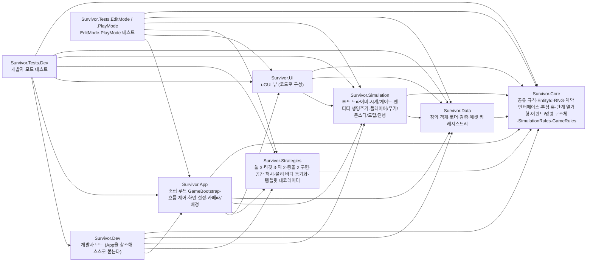
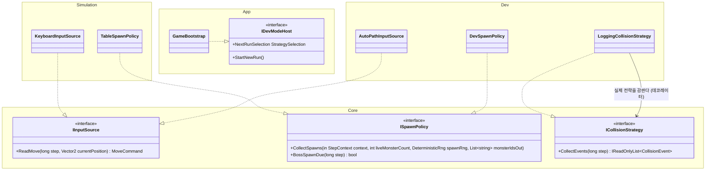
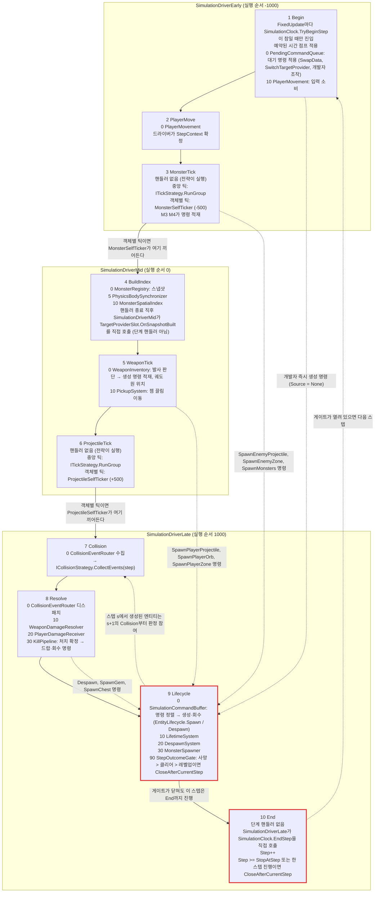
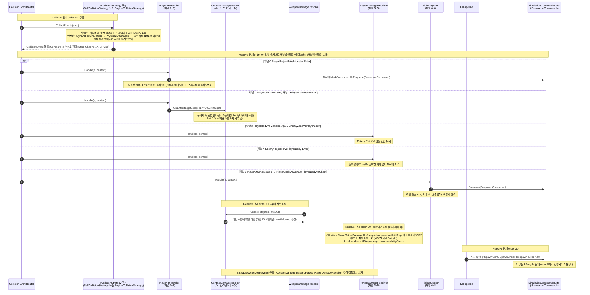

# 아키텍처 다이어그램 (초안)

> 이 문서는 `TECH_SPEC.md` 4회차 기준의 **초안**이며 구현 전이다. 그림의 이름은 전부 TECH_SPEC에 적힌 것이고, 코드는 아직 없다.
> 구현 뒤 F12에서 README로 흡수한다.
> 코드와 다르면 둘 중 하나가 틀린 것이므로 `RUN_LOG.md`에 기록하고 고친다.

출처 절: 5.0·5.0.1(어셈블리·인터페이스 목록), 5c.1(참조 방향), 5.3(스텝·게이트), 5.4·5.10(명령·생명주기), 5.9·5.12(충돌·피해), 5.11(데이터), 5c.2(소유권), 3절(기능 목록), 5c.3 #9(단계 핸들러 order).

---

## 그림 1. 어셈블리 의존 그래프

화살표는 "참조한다"이다. 5c.1 참조 방향 표의 행을 그대로 옮겼다. 노드의 설명은 5.0 표의 내용 열이다. `Survivor.Editor`는 참조가 없어(`EditorPrefs` 키 문자열만 사용) 화살표가 없으므로 그리지 않았다.

없는 화살표가 규칙이다. (예: Simulation과 Strategies는 서로 참조하지 않고 Core의 추상 훅으로만 이어지며, 어떤 게임 어셈블리도 Dev를 참조하지 않는다.)

---

## 그림 2. 인터페이스와 구현체

5.0.1 표의 인터페이스 15개를 세 장에 나눠 그렸다. 인터페이스는 `<<interface>>`, 구현은 `..|>`이고 `namespace` 블록이 어셈블리다. 메서드는 5.x 시그니처에서 핵심만 옮겼고 필드는 생략했다. `ISimulationCommandHandler`와 `ICollisionEventHandler`는 5.0.1 표에 따라 Simulation 소속이다.

| 장 | 인터페이스 | 수 |
|---|---|---|
| 2a Core 계약 (전략 4축·템플릿/물리 훅) | `IPoolStrategy`, `ITargetProvider`, `ITickStrategy`, `IUpdatable`, `ICollisionStrategy`, `IEntityTemplateDecorator`, `IPhysicsBodyRegistry` | 7 |
| 2b Simulation 계약 (단계·시계·명령·이벤트) | `IStepPhaseHandler`, `IStepClockReader`, `ISimulationCommands`, `ISimulationCommandHandler`, `ICollisionEventHandler` | 5 |
| 2c 개발자 모드 주입 경계 | `IInputSource`, `ISpawnPolicy`, `IDevModeHost` | 3 |
| 합계 | | 15 |

### 2a. Core 계약

```mermaid
classDiagram
    namespace Core {
        class IPoolStrategy {
            <<interface>>
            +Acquire(GameObject template, Vector2 position) GameObject
            +Release(GameObject instance)
        }
        class ITargetProvider {
            <<interface>>
            +OnSnapshotBuilt(MonsterSnapshotBuffer snapshot)
            +TryFindNearest(Vector2 point, out TargetHit hit) bool
        }
        class ITickStrategy {
            <<interface>>
            +Register(IUpdatable updatable, GameObject host)
            +RunGroup(TickGroup group, in StepContext context)
        }
        class IUpdatable {
            <<interface>>
            +Tick(in StepContext context)
        }
        class ICollisionStrategy {
            <<interface>>
            +Register(CollisionBody body)
            +CollectEvents(long step) IReadOnlyList~CollisionEvent~
        }
        class IEntityTemplateDecorator {
            <<interface>>
            +Decorate(GameObject template, EntityCategory category)
        }
        class IPhysicsBodyRegistry {
            <<interface>>
            +Register(CollisionBody body)
            +Unregister(CollisionBody body)
        }
    }
    namespace Strategies {
        class CustomPoolStrategy
        class InstantiatePoolStrategy
        class UnityObjectPoolStrategy
        class BruteForceTargetProvider
        class SpatialHashTargetProvider
        class Physics2DTargetProvider
        class CentralTickStrategy
        class SelfTickStrategy
        class SelfCollisionStrategy
        class EngineCollisionStrategy
        class PoolTemplateDecorator
        class CollisionTemplateDecorator
        class SelfTickTemplateDecorator
        class PhysicsBodySynchronizer
    }
    namespace Simulation {
        class TargetProviderSlot
        class Monster
        class PlayerProjectile
        class EnemyProjectile
    }

    CustomPoolStrategy ..|> IPoolStrategy
    InstantiatePoolStrategy ..|> IPoolStrategy
    UnityObjectPoolStrategy ..|> IPoolStrategy

    BruteForceTargetProvider ..|> ITargetProvider
    SpatialHashTargetProvider ..|> ITargetProvider
    Physics2DTargetProvider ..|> ITargetProvider
    TargetProviderSlot ..|> ITargetProvider

    CentralTickStrategy ..|> ITickStrategy
    SelfTickStrategy ..|> ITickStrategy

    Monster ..|> IUpdatable
    PlayerProjectile ..|> IUpdatable
    EnemyProjectile ..|> IUpdatable

    SelfCollisionStrategy ..|> ICollisionStrategy
    EngineCollisionStrategy ..|> ICollisionStrategy

    PoolTemplateDecorator ..|> IEntityTemplateDecorator
    CollisionTemplateDecorator ..|> IEntityTemplateDecorator
    SelfTickTemplateDecorator ..|> IEntityTemplateDecorator

    PhysicsBodySynchronizer ..|> IPhysicsBodyRegistry
```

`TargetProviderSlot`은 현재 공급자를 감싸 위임한다(5.0.1 "위임"). `LoggingCollisionStrategy`(Dev)는 2c에 있다.

### 2b. Simulation 계약

```mermaid
classDiagram
    namespace Core {
        class IStepPhaseHandler {
            <<interface>>
            +OnPhase(SimulationPhase phase, in StepContext context)
        }
        class IStepClockReader {
            <<interface>>
            +StepActive bool
            +Step long
        }
        class ISimulationCommands {
            <<interface>>
            +Enqueue(in SimulationCommand command)
        }
    }
    namespace Simulation {
        class ISimulationCommandHandler {
            <<interface>>
            +Handle(in SimulationCommand command, in StepContext context)
        }
        class ICollisionEventHandler {
            <<interface>>
            +Handle(in CollisionEvent e, in StepContext context)
        }
        class PendingCommandQueue
        class PlayerMovement
        class MonsterRegistry
        class WeaponInventory
        class PickupSystem
        class CollisionEventRouter
        class WeaponDamageResolver
        class PlayerDamageReceiver
        class KillPipeline
        class SimulationCommandBuffer
        class LifetimeSystem
        class DespawnSystem
        class MonsterSpawner
        class StepOutcomeGate
        class SimulationClock
        class EntityDespawnCommandHandler
        class PlayerSpawnCommandHandler
        class MonsterCommandHandler
        class DropCommandHandler
        class PlayerHitHandler
    }
    namespace Strategies {
        class PhysicsBodySynchronizer
        class MonsterSpatialIndex
    }

    PendingCommandQueue ..|> IStepPhaseHandler
    PlayerMovement ..|> IStepPhaseHandler
    MonsterRegistry ..|> IStepPhaseHandler
    WeaponInventory ..|> IStepPhaseHandler
    PickupSystem ..|> IStepPhaseHandler
    CollisionEventRouter ..|> IStepPhaseHandler
    WeaponDamageResolver ..|> IStepPhaseHandler
    PlayerDamageReceiver ..|> IStepPhaseHandler
    KillPipeline ..|> IStepPhaseHandler
    SimulationCommandBuffer ..|> IStepPhaseHandler
    LifetimeSystem ..|> IStepPhaseHandler
    DespawnSystem ..|> IStepPhaseHandler
    MonsterSpawner ..|> IStepPhaseHandler
    StepOutcomeGate ..|> IStepPhaseHandler
    PhysicsBodySynchronizer ..|> IStepPhaseHandler
    MonsterSpatialIndex ..|> IStepPhaseHandler

    SimulationClock ..|> IStepClockReader
    SimulationCommandBuffer ..|> ISimulationCommands

    EntityDespawnCommandHandler ..|> ISimulationCommandHandler
    PlayerSpawnCommandHandler ..|> ISimulationCommandHandler
    MonsterCommandHandler ..|> ISimulationCommandHandler
    DropCommandHandler ..|> ISimulationCommandHandler

    PlayerHitHandler ..|> ICollisionEventHandler
    PlayerDamageReceiver ..|> ICollisionEventHandler
    PickupSystem ..|> ICollisionEventHandler
```

### 2c. 개발자 모드 주입 경계

`ICollisionStrategy`는 2a에서 정의한 것을 데코레이터 관계를 보이려고 다시 그렸다(15개 집계에는 한 번만 센다). `IDevModeHost`는 App 소속이고 Dev가 App을 참조해 이것에 붙는다(5.15).

---

## 그림 3. 고정 스텝 파이프라인

5.3의 `SimulationPhase` 10단계다. 노드 안 숫자는 5c.3 #9의 핸들러 `order`이다. 실선은 단계 진행, 점선은 5.4의 지연 명령이 Lifecycle 0번(`SimulationCommandBuffer`)에서 적용되는 경로다. 붉은 테두리는 게이트가 닫히는 지점이다.

읽는 법과 보충:

- **명령이 쌓이는 곳**: Begin(개발자 대기 명령), MonsterTick(M3·M4), WeaponTick(무기), Resolve(소모·처치). **적용되는 곳**은 Lifecycle 0번 한 곳이며 (Source, Sequence) 순서로 정렬해 `EntityDespawnCommandHandler`·`PlayerSpawnCommandHandler`·`MonsterCommandHandler`·`DropCommandHandler`로 넘긴다(5.4).
- **생성·회수(5.10)**: `EntityLifecycle.Spawn`·`Despawn`은 Lifecycle 단계와 판 리셋(`RunSession.Reset`의 `DespawnAll`)에서만 성공한다. Lifecycle 안에서 `EntityLifecycle`을 직접 부르는 핸들러는 `LifetimeSystem`·`DespawnSystem`·`MonsterSpawner` 셋이고, 나머지는 `SimulationCommandBuffer`를 거친다.
- **게이트가 닫히는 지점(스텝 안)**: Lifecycle order 90 `StepOutcomeGate`(사망·클리어·레벨업)와 End의 `EndStep`(StopAtStep·한 스텝 진행). 둘 다 `CloseAfterCurrentStep`이며 진행 중인 스텝은 End까지 끝까지 돌고, 다음 `FixedUpdate`부터 스텝이 돌지 않는다.
- **그 밖의 닫힘**: 스텝 밖에서는 `Close`(일시정지·포커스 상실·판 리셋, `Update`에서 호출). 단계 중 예외는 드라이버의 `AbortStep`(게이트 `Error`, `Step` 증가 없음). 열기는 FLOW의 `Open` 하나다. 이 경로들은 스텝 단계가 아니어서 그림에 노드로 넣지 않았다.

---

## 그림 4. 충돌 이벤트 흐름

5.9·5.12의 이름만 썼다. 피해 규칙 세 갈래(일회성 접촉 / 공격자 측 쌍별 쿨다운 / 플레이어 공통 무적)가 어느 참여자에게 있는지를 메모로 표시했다.

---

## 그림 5. 데이터 흐름

5.11·5.11.0의 클래스 이름만 썼다. 부팅 때 최초 로드는 `GameBootstrap.Awake`가 한 번 하고, 개발자 모드 핫 리로드는 같은 `LoadAll`(같은 검증 순서)을 거쳐 `SwapData` 대기 명령으로 다음 스텝 Begin에서 교체된다(5.11.1). 검증 순서는 5.11.0의 고정 순서 ①~⑥이다.

```mermaid
flowchart LR
    subgraph FILES["StreamingAssets/Data  JSON 7종"]
        direction TB
        FW["weapons.json  필수"]
        FM["monsters.json  필수"]
        FS["spawnTable.json  필수"]
        FP["playerStats.json  필수"]
        FC["combinations.json  선택"]
        FPA["passives.json  선택"]
        FL["levelUpPool.json  선택"]
    end

    BOOT["GameBootstrap.Awake  IMP-FLOW<br/>부팅 때 최초 로드 1회<br/>SimulationSettingsApplier → PhysicsSettingsApplier → DisplaySetup 다음"]
    LOAD["GameDataLoader.LoadAll(Application.streamingAssetsPath)  IMP-DATA<br/>① 파일별 읽기: File.ReadAllText UTF-8<br/>U+FFFD가 있으면 인코딩 경고"]
    PARSE["② JsonTreeReader<br/>Newtonsoft JToken.Parse, 파일 단위 실패 판정<br/>필수 4종 누락 또는 전체 파싱 실패 → Blocking<br/>선택 3종 → Warning 후 폴백"]
    BIND["③ Binders/*  7종 고정 순서<br/>PlayerStats, Weapons, Passives, Monsters, SpawnTable, Combinations, LevelUpPool<br/>필드 바인딩·정의 단위 검증·ID 중복·초 → 스텝 환산<br/>정의 단위 오류는 그 정의만 건너뛰기 (PlayerStats는 Blocking)"]

    subgraph VALID["검증 (LoadAll 내부 고정 순서)"]
        direction TB
        V4["④ 파일 간 참조 검증<br/>조합·스폰 테이블·startingWeaponId·보스 소환 monsterId"]
        V5["⑤ PlayabilityChecker<br/>플레이 불가 4기준"]
        V6["⑥ TunnelingInvariantValidator.Validate<br/>v/60 ≤ r 경고만, 차단하지 않음"]
        V4 --> V5 --> V6
    end

    REPORT["DataValidationReport<br/>Issues, BlockingIssues, IsPlayable"]
    GD["GameData  불변"]
    INIT["GameDataRegistry.Initialize(data, report)<br/>부팅 때 1회: report는 항상 저장<br/>Current는 IsPlayable일 때만 설정"]
    REG["GameDataRegistry.Current"]
    TITLE["FlowState.Title"]
    ERR["FlowState.DataError<br/>시작 차단 화면 + LastReport.BlockingIssues 표시<br/>Current는 null"]
    HOTERR["기존 데이터 유지, 오류만 표시"]

    AKR["Resources/AssetKeyRegistry.asset<br/>AssetKeyRegistry"]
    AKRES["AssetKeyResolver<br/>없는 키는 기본 도형 + 키당 1회 경고"]

    subgraph CONS["소비자"]
        direction TB
        C3["F3  MonsterSpawner<br/>SpawnTable, Monsters"]
        C5["F5  LevelUpCandidateBuilder<br/>Passives, LevelUpPool, Weapons"]
        C6["F6  WeaponFactory<br/>WeaponDefinition"]
        C7["F7  EvolutionService<br/>Combinations"]
    end

    subgraph HOT["개발자 모드 핫 리로드  Survivor.Dev"]
        direction TB
        HR["HotReloadService"]
        PCQ["PendingCommandQueue<br/>SwapData 대기 명령"]
        SWAP["다음 스텝 Begin<br/>GameDataRegistry.TrySwap"]
    end

    BOOT --> LOAD
    FILES --> LOAD --> PARSE --> BIND
    BIND --> VALID
    BIND --> GD
    VALID --> REPORT
    GD --> REPORT
    REPORT --> INIT
    GD --> INIT
    INIT -->|"IsPlayable"| TITLE
    INIT -->|"IsPlayable == false"| ERR
    INIT --> REG
    AKR --> AKRES
    AKRES --> REPORT
    REG --> CONS
    AKRES -.->|"생성 시점에 VisualAsset 해석"| CONS

    HR -.->|"LoadAll 재호출: 같은 검증 순서"| LOAD
    HR -->|"플레이 가능하면"| PCQ
    PCQ --> SWAP
    SWAP -->|"교체 성공: Swapped 이벤트"| REG
    SWAP -.->|"플레이 불가면 기존 데이터 유지, 오류만 표시"| ERR
```

---

## 표. 기능 ID - 구현자 - 주요 클래스

3절 기능 목록의 담당 구현자와 5c.2 파일 소유권 맵을 합쳤다. 대표 클래스는 해당 구현자가 소유한 파일의 클래스 중 2~3개이며, 소유자가 다르면 괄호에 적었다.

| ID | 기능 | 담당 구현자 | 대표 클래스 |
|---|---|---|---|
| F1 | 플레이어 이동 | IMP-PLAYER (입력 소스: IMP-LOOP, 카메라 스냅: IMP-FLOW) | `PlayerMovement`, `KeyboardInputSource` (LOOP), `CameraFollow` (FLOW) |
| F2 | 자동 공격 | IMP-PLAYER | `WeaponInventory`, `WeaponInstance` |
| F3 | 몬스터 | IMP-MONSTER | `Monster`, `MonsterSpawner`, `SpawnScheduler` |
| F4 | 아이템 드랍과 획득 | IMP-MONSTER (상자 효과 결정·적용: IMP-PLAYER) | `KillPipeline`, `PickupSystem`, `ChestEffectResolver` (PLAYER) |
| F5 | 레벨업과 선택지 | IMP-FLOW (선택 적용: IMP-PLAYER) | `LevelUpSession`, `LevelUpCandidateBuilder`, `PlayerProgressionApplier` (PLAYER) |
| F6 | 무기 시스템 | IMP-PLAYER | `WeaponFactory`, `ProjectileWeapon`, `ContactDamageTracker` |
| F7 | 조합(진화) | IMP-PLAYER | `EvolutionService`, `PlayerProgressionApplier` |
| F8 | 스테이지와 게임 종료 흐름 | IMP-FLOW | `GameFlowController`, `RunSession`, `DisplaySetup` |
| F9 | 오브젝트 풀링 | IMP-POOL | `CustomPoolStrategy`, `InstantiatePoolStrategy`, `UnityObjectPoolStrategy` |
| F10 | 성능 측정과 비교 기록 | IMP-DEV (측정 훅) / 사용자 (측정 수행) | `StatsCollector`, `MeasurementSession`, `MeasurementCsvExporter` |
| F11 | 데이터 기반 설계 | IMP-DATA | `GameDataLoader`, `GameDataRegistry`, `DataValidationReport` |
| F12 | README | doc-writer | 해당 없음 (문서) |
| F13 | 빌드와 시연 영상 | 사용자 / IMP-FLOW (창 설정 코드) | `DisplaySetup`, `WindowSizeSelector` |
| F14 | 품질 관리 기록 | 사용자 (`docs/devlog.md` 틀: doc-writer) | 해당 없음 (문서) |
| F15 | 개발 환경과 저장소 | 사용자 | 해당 없음 (폴더 구조는 5c.1) |
| F16 | 타깃 탐색 전략 | IMP-SPATIAL | `MonsterSpatialIndex`, `SpatialHash`, `Physics2DTargetProvider` |
| F17 | Update 집중화 전략 | IMP-LOOP | `CentralTickStrategy`, `SelfTickStrategy`, `MonsterSelfTicker` |
| F18 | 충돌 판정 전략 | IMP-COLLISION | `SelfCollisionStrategy`, `EngineCollisionStrategy`, `PhysicsBodySynchronizer` |
| F19 | 개발자 모드 | IMP-DEV | `DevModeEntry`, `DevController`, `DevOverlay` |
| (ID 없음) | 공통 기반 (고정 스텝·객체 ID·피해 규칙·RNG·공유 규칙) | IMP-CORE / IMP-LOOP / IMP-PLAYER | `EntityId` (CORE), `SimulationClock`, `EntityLifecycle` (LOOP) |

---

## 대조 체크리스트 (F12용)

구현 뒤 코드와 대조해 아래 숫자가 계속 맞는지 확인한다.

- [ ] 5.0.1의 인터페이스 15개가 그림 2에 전부 있다 (지금: 15 / 15, 2a 7 + 2b 5 + 2c 3. 구현 클래스는 고유 45개, 구현 관계선 49개)
- [ ] 5c.1 참조 방향 표의 화살표 수와 그림 1의 화살표 수가 같다 (지금: 30 / 30. `Survivor.Tests.EditMode`와 `.PlayMode`는 표의 한 행이라 한 노드로 합쳤다)
- [ ] 5.3 단계 수와 그림 3 노드 수가 같다 (지금: 10 / 10)

---

## 그리지 못한 것

| 항목 | 이유 |
|---|---|
| `Survivor.Editor` 어셈블리 | 5c.1 표에서 참조가 없어 화살표가 0개라 그림 1에 넣지 않았다 |
| `TargetProviderSlot`의 BuildIndex 핸들러 관계 | 5c.3 #9는 BuildIndex order 20에 `TargetProviderSlot.OnSnapshotBuilt`를 적었지만 5.0.1은 `TargetProviderSlot`을 `IStepPhaseHandler` 구현으로 올리지 않았다. 그림 3의 노드 라벨에만 적고 그림 2b에는 `IStepPhaseHandler` 관계를 그리지 않았다 |
| 검증 단계 내부의 호출 순서 | Binders, `PlayabilityChecker`, `TunnelingInvariantValidator`의 호출 순서와 `PlayabilityChecker`를 누가 부르는지 5.11에 적혀 있지 않아 그림 5는 검증 묶음 하나로만 그렸다 |
| 시작 시 최초 로드의 `GameDataRegistry` 설정 경로 | 부팅 때 누가 `LoadAll` 결과를 레지스트리에 넣는지 5.11에 없다 (`TrySwap`과 핫 리로드만 명시) |
| 스텝 밖 게이트 닫힘(`Close`)·`AbortStep`·`Open` | 단계가 아니라 스텝 밖/예외 경로라 그림 3의 노드 수(10)를 지키려고 본문 설명으로만 적었다 |
