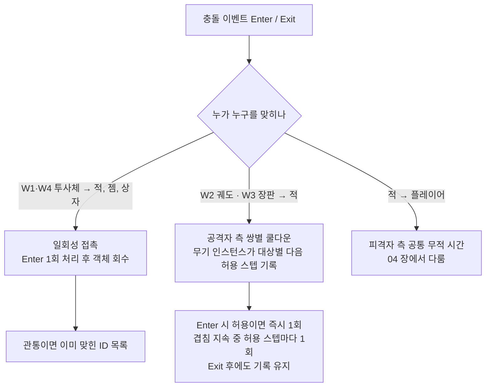
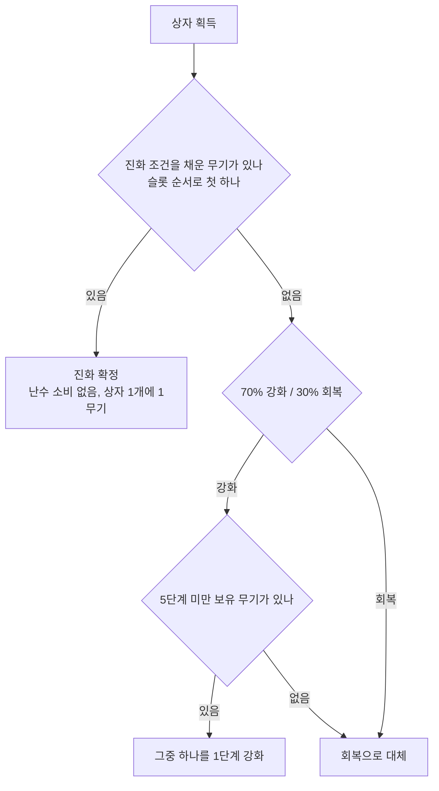

# 05. 무기 규칙 — 자동 공격, W1~W4, 강화와 진화

> 기준: PRD(동결) · SPEC 6회차 · TECH_SPEC 5회차 · RUN_LOG 2026-10-23 · 독자: 학습용 상세판
> 원천을 고치지 않는 파생 문서다. SPEC·TECH가 개정되면 이 스탬프와 본문을 재동기화한다.

## 1. 이 장에서 배우는 것

- 무기는 입력 없이 스스로 쏘며, "가장 가까운 적"은 `ITargetProvider` 하나로만 묻는다. 무기 네 종은 투사체·궤도·장판·유도라는 서로 다른 피해 적용 방식을 하나씩 맡는다.
- 피해는 세 갈래(일회성 접촉 / 공격자 측 쌍별 쿨다운 / 피격자 측 무적)로만 들어가고, 충돌 전략은 Enter·Exit만 알려 준다. 이 장은 그중 무기가 쓰는 앞의 두 갈래를 다룬다.
- 무기는 5단계까지 강화되고, 상자를 먹을 때에만 W1·W2가 E1·E2로 진화한다. "명중 시 소멸" 같은 흩어진 규칙을 4.2~4.6에서 한 곳에 모았다.

## 2. 의도

**왜 자동 공격인가.** 장르의 정체성이기도 하지만, 이 프로젝트에서는 설계 이유가 하나 더 있다. 무기가 매 스텝 "가장 가까운 적"을 묻는 호출이 곧 타깃 탐색 전략(F16)의 측정 부하이기 때문이다. 그래서 무기 코드는 `ITargetProvider`만 호출하고 구현 클래스를 직접 참조하지 못한다. 또 W1을 들고 시작하는 것(RUN_LOG 2026-10-10, Q7)은 무기 없이 시작하면 적을 못 죽여 경험치가 안 모이고 첫 레벨업이 영영 오지 않기 때문이다.

**왜 무기가 네 가지 행동 타입인가.** 2026-10-10 라운드 3에서 무기 4종을 "측정 축의 부하원과 1:1로 연결해" 골랐다. 원천에 명시된 대응은 W1·W4가 타깃 탐색 소비자, W2가 충돌 판정의 주 소비자라는 것이다. 여기서 풀어 쓰면 다음과 같다(W3 항목은 원천에 대응이 따로 적혀 있지 않아 TECH 규칙에서 읽어 낸 해설이다).

| 타입 | 피해를 주는 방식 | 타깃 탐색 부하 |
|---|---|---|
| W1 투사체 | 일회성 접촉, 방향 고정 | 발사할 때 1회 |
| W2 궤도 | 지속 접촉, 공격자 측 쌍별 쿨다운 | 없음 (플레이어 위치 기준 회전) |
| W3 장판 | 지속 접촉, 공격자 측 쌍별 쿨다운 | 생성할 때 1회 (위치 결정용) |
| W4 유도 | 일회성 접촉, 방향을 매 스텝 갱신 | 투사체마다 매 스텝 1회 |

**왜 무기 모양이 전부 원인가.** 2026-10-12(Q23 재수정)에서 충돌 판정 다섯 쌍을 전부 자체 구현으로 확정했는데, 이때 "무기 모양을 우리가 정하니 궤도를 작은 원 몇 개, 장판을 원형 영역으로 정의하면 판정이 전부 원-원이 되어 함수 하나로 끝난다"는 근거가 나왔다. 반지름 한 값이 판정 크기와 터널링 불변식(`속도/60 ≤ 반지름`, Q35)을 동시에 정하는 부수 효과도 있다.

**왜 진화는 상자를 거치는가.** 처음에는 조건만 채우면 자동 진화였다. 2026-10-12에 사용자가 상자 경유를 제안했고, 상자가 한 판에 30~50개 나온다는 추정과 함께 "자동 진화는 수백 마리가 깔린 화면에서 조용히 일어나 눈치채기 어렵지만, 상자 경유는 진화에 획득 순간을 만든다"는 점이 채택 이유가 되었다(Q10 재수정, Q5 우선순위). 진화 무기가 추가 강화를 갖지 않는 것은 Q30, 둘이 동시에 조건을 채웠을 때 슬롯 번호가 작은 쪽부터 진화시키는 것은 Q42(기본값 채택)다.

## 3. 플레이어 관점 시나리오

**시나리오 A. 시작 10초, 적 셋이 보이고 W1만 있다.**
플레이어는 W1 1단계를 들고 시작한다. W1의 쿨다운은 "다음 발사 허용 스텝"으로 관리되므로, 허용 스텝이 되고 화면에 적이 있는 스텝에 무기가 `ITargetProvider`에게 플레이어 위치에서 가장 가까운 적을 묻는다. 셋 중 거리가 가장 짧은 적이 답이 되고, 거리가 같으면 ID가 작은 적이 답이다. 무기는 그 방향으로 투사체 생성 명령을 넣고, 같은 스텝의 생성 단계에서 투사체가 나타난다. 발사 후 방향은 바뀌지 않는다. 이후 매 스텝 투사체가 직진하다가 적과 처음 겹친 스텝(Enter)에 피해를 주고 그 자리에서 회수된다. 적의 체력이 0 이하가 되면 처치 처리로 넘어가 경험치 젬이 떨어진다. 투사체가 아무와도 만나지 못하면 수명이 끝날 때 조용히 사라진다. 적이 없는 스텝에는 아무것도 쏘지 않고 쿨다운도 소비하지 않으니, 적이 나타나는 첫 스텝에 바로 발사된다.

**시나리오 B. W2·W3를 들고 적 무리 한가운데를 가로지른다.**
W2의 궤도 원 몇 개는 무기를 얻은 순간부터 플레이어 주변을 계속 돈다. 수명도 재생성 쿨다운도 없다. W3는 쿨다운이 되면 가장 가까운 적의 위치(플레이어 위치가 아니다)에 원형 장판을 깔고, 장판은 지속시간이 지나면 사라진다. 무리 속으로 들어가면 궤도 원이 적과 겹치는 순간(Enter) 허용 상태이면 즉시 1회 피해를 주고, 겹침이 이어지는 동안 틱 간격마다 한 번씩 더 준다. 적이 원 밖으로 밀려났다가 틱 간격 안에 다시 겹쳐도 피해는 한 번 더 들어가지 않는다. Exit 뒤에도 "다음 허용 스텝" 기록이 남아 있기 때문이다. 장판 위에 선 적도 똑같은 규칙으로 맞는다. 한편 같은 무리가 플레이어를 때리는 쪽의 피해는 이 장이 아니라 04(무적 시간)의 몫이다.

## 4. 규칙

### 4.1 자동 공격과 타깃 선택 (F2)

모든 무기는 자기만의 `_nextFireStep`을 가진다. 발사 조건은 `현재 스텝 ≥ _nextFireStep`, 무기 활성화 규칙이 켜져 있음, 타깃이 있음 세 가지이고, 발사하면 `_nextFireStep = 현재 스텝 + 유효 쿨다운`으로 갱신한다. 타깃이 없으면 발사하지도 않고 `_nextFireStep`도 건드리지 않아 다음 스텝에 다시 시도한다. 여러 무기를 가지면 각 무기가 독립된 쿨다운을 가진다. 쿨다운이 실수 시간이 아니라 스텝 번호이고 일시정지·레벨업 선택 중에는 스텝이 돌지 않으므로, 그 사이 쿨다운은 진행되지 않는다.

**`ITargetProvider`란.** 무기가 "지금 가장 가까운 몬스터가 누구인가"를 묻는 유일한 창구다. `TryFindNearest(point, out hit)` 하나가 핵심이고, 몬스터가 하나도 없으면 예외 없이 `false`를 돌려준다. 구현은 전수 순회·공간 해시·`Physics2D` 쿼리 세 가지이며, 어느 것을 쓰든 결과가 같아야 한다. 같음의 기준은 제곱거리가 작은 쪽, 같으면 `EntityId`가 작은 쪽이다. 질의 대상은 그 스텝 초반에 얼려 둔 몬스터 위치 스냅샷이다. 몬스터가 플레이어를 쫓는 일에는 쓰이지 않는다(몬스터는 플레이어 위치를 직접 읽는다). 무기가 구현 클래스를 직접 참조하면 어셈블리 참조가 없어 컴파일 자체가 안 된다.

**패시브 P1이 어디에 걸리는가.** 유효 쿨다운은 `max(1, round(기본 스텝 / (1 + 보너스)))`다. 기본값(TECH D14)은 W1·W3·W4의 쿨다운과 W2의 틱 간격에 적용하고 W3 장판 내부의 틱 간격에는 적용하지 않는 것이다. 자세한 것은 04 장에서 다룬다.

### 4.2 W1 투사체

발사 순간 가장 가까운 적 쪽 방향을 한 번 정하고(적과 플레이어 위치가 겹쳐 방향이 영벡터면 오른쪽), 이후 방향을 바꾸지 않는다. 사거리 제한은 없고 수명(스텝)이 끝나면 사라진다. 적 1기와 Enter하면 피해를 주고 소멸한다. 4~5단계는 `projectileCount`가 2라서 같은 스텝에 투사체가 여러 개 나가며 `spreadDegrees`를 균등 분할한다.

**"명중 시 소멸"이 네 곳에 나뉘어 있던 것의 정리.** 규칙은 하나다: *W1·W4 투사체는 적과의 첫 Enter에서 피해를 주고 소멸한다(관통 없음).* SPEC 3.0 I가 "일회성 접촉"이라는 분류로 이를 정하고, F6 수용 기준이 W1·W4에 적용하며, TECH TAC-F6-9가 구현 방식(채널 0 Enter 1회에 피해 → `Consumed` 표시 → 회수 명령, 같은 스텝의 다른 Enter는 `Consumed`라 무시)을 정하고, 스키마의 `pierceCount`(기본 0)가 이를 데이터로 열어 둔다. `pierceCount > 0`이면 "이미 맞힌 ID 목록"으로 같은 적을 두 번 때리지 않고 `pierceCount + 1`번째 명중에서 소멸한다. 기본 무기 네 종은 모두 0이므로 관통은 JSON으로 새 무기를 추가할 때만 의미가 있다.

### 4.3 W2 근접 회전

궤도 원 `orbCount`개가 플레이어 주변 `orbitRadius`에서 돈다. i번째 원의 위치는 `플레이어 위치 + R·(cosθ_i, sinθ_i)`, `θ_i = θ0 + ω·스텝 + 2π·i/orbCount`로, 스텝 번호에서 직접 계산하므로 오차가 누적되지 않는다. 원은 보유하는 동안 상시 존재한다(2026-10-21 사용자 확정, SPEC 6회차). 회수되는 경우는 셋뿐이다: 진화로 교체될 때, 단계가 바뀌어 `orbCount`가 줄었을 때의 초과분(인덱스가 큰 것부터), 런 종료·재시작. 핫 리로드는 이미 가진 무기 인스턴스를 바꾸지 않으므로 여기에 들지 않는다. 구현상 `lifetimeSteps = 0`을 "수명 없음"으로 읽는 규약이라 `LifetimeSystem`이 건너뛴다. 피해는 4.6의 쌍별 쿨다운으로 들어간다.

### 4.4 W3 장판

쿨다운이 되면 가장 가까운 적의 위치(Q8 기본값)에 반지름 `zoneRadius`의 원형 장판을 만든다. 적이 없으면 장판도 쿨다운 소비도 없이 다음 스텝에 다시 시도한다(Q46 ②, W1과 같은 규칙). 장판은 생성 스텝부터 `durationSeconds`가 지나면 수명 만료로 회수된다. 피해는 4.6의 쌍별 쿨다운이다. 생성 스텝에는 아직 피해가 없고 첫 피해는 "발사 스텝 + 1"이다. 모든 무기 산출물이 같은 스텝 생성 단계에서 만들어지기 때문이고, 덕분에 충돌 전략 A·B에서 첫 피해 스텝이 같다.

### 4.5 W4 유도 투사체

W1과 같은 `ProjectileWeapon` 경로에서 나오되 투사체가 "재조준 모드"다. 매 스텝 자기 위치에서 가장 가까운 적을 다시 찾아 진행 방향을 갱신한다. 추적하던 적이 죽거나 사라지면 따로 처리할 것 없이 다음 스텝의 재탐색이 새 가장 가까운 적을 고른다. 적이 하나도 없으면 마지막 방향으로 직진하고, 수명이 끝나면 소멸한다(Q9). W1과 마찬가지로 사거리 제한은 없고 첫 Enter에서 피해를 주고 소멸한다. 코드에서 W4를 나타내는 방법은 `behavior: "homing"` 하나뿐이다.

**W1과 W4의 실질 차이.** 둘 다 "작은 원이 날아가 적 1기를 맞히고 사라진다"는 점은 같다. 아래는 원천 규칙에서 풀어 쓴 해설이다.

| 구분 | W1 | W4 |
|---|---|---|
| 방향 결정 | 발사 순간 1회, 이후 고정 | 매 스텝 갱신 |
| 재조준 기준점 | 해당 없음 (발사 때만 플레이어 위치 기준) | **투사체 자신의 현재 위치** |
| 적중률 | 대상이 움직이면 빗나갈 수 있음 | 날아가는 도중 방향을 고쳐 추격 |
| 타깃 탐색 호출 | 무기당 발사 1회 | 투사체 수 × 비행 스텝 수 |
| 대상이 죽으면 | 영향 없음 (이미 직진 중) | 다음 스텝에 새 가장 가까운 적으로 교체 |

재조준의 기준이 플레이어가 아니라 투사체 자신의 위치라는 점이 핵심이다. 투사체 곁에서 가장 가까운 적이 따로 있으면 처음 겨눈 적이 아니라 그 적을 쫓으므로, W4는 "처음 고른 적을 끝까지 쫓는 무기"가 아니다. 이 매 스텝 호출이 곧 타깃 탐색 전략 비교(F16)에서 W4가 W1보다 훨씬 무거운 소비자인 이유다. 스키마상 두 무기의 차이는 `behavior` 값 하나와 5절 표 5-2와 5-3의 수치뿐이다.

### 4.6 피해가 적용되는 세 가지 방식 (SPEC 3.0 I)

충돌 판정 전략(F18)은 새로 겹친 스텝(Enter)과 겹침이 끝난 스텝(Exit) 두 종류만 보고한다. 겹쳐 있는 동안의 스텝에는 이벤트가 없다. "누가 겹쳐 있는가, 언제 피해를 주는가"는 전략과 무관한 게임 로직 하나가 전담한다. 이 결정은 2026-10-16 Q41에서 "겹친 뒤 매 스텝 피해를 어떻게 막는가"라는 질문을 계기로 확정되었다.

**왜 "매 스텝 피해"가 안 되는가.** 궤도 원 하나가 적과 겹쳐 있는 시간은 보통 수십 스텝이다. 겹침 스텝마다 피해를 주면 초당 60번 맞는 셈이 되어 틱 간격이라는 개념이 사라진다. 그렇다고 "이벤트가 올 때만 피해를 준다"로 두면 Enter 한 번에 한 대만 맞고 끝난다. 그래서 지속 접촉 무기는 무기 인스턴스가 대상 ID별로 다음 허용 스텝을 들고 있다가 틱 간격마다 한 번씩 피해를 준다(`ContactDamageTracker`). 이 기록은 대상이 Exit한 뒤에도 허용 스텝까지 유지한다. 지우면 경계를 들락거리는 것만으로 쿨다운을 우회할 수 있기 때문이다. 대상이 풀로 반납되면 Exit 이벤트가 오지 않으므로 반납 시 기록을 직접 지운다. 키는 세대가 붙은 `EntityId`라서, 같은 인덱스를 물려받은 새 몬스터가 이전 몬스터의 쿨다운을 물려받는 일이 없다.

**왜 Enter·Exit만 쓰는가.** 충돌 판정 구현이 둘(엔진 콜백 기반, 자체 폴링 기반)이고 성격이 반대다. 둘이 보고하는 이벤트 종류를 Enter·Exit로 통일하면 "누가 언제 얼마를 받았는가"를 계산하는 로직이 하나로 유지되고, 전략을 바꿔도 피해 결과가 같다는 동등성 검증(E1)의 전제가 선다.

적이 플레이어를 때리는 쪽(세 번째 갈래)은 쌍별로 하면 적 400기가 겹칠 때 즉사하므로 피격자 측 공통 무적 시간을 쓴다. 이 장이 아니라 04에서 다룬다.

### 4.7 강화 5단계와 슬롯 4개

무기는 최대 4개, 패시브는 최대 3개를 가지고 각각 5단계까지 올린다. 무기 정의의 `levels[i]`는 (i+1)단계의 절대값 전체 집합이다. 증분이 아니라 통째로 갈아 끼우는 방식이다. 단계는 올라가기만 하고 6단계 이상은 없다. 진화 무기는 `levels`가 정확히 1개이고 강화 대상이 아니다. 무기를 얻는 길은 둘이다. 레벨업 선택지에서 "새 무기"를 고르면 가장 앞의 빈 슬롯에 1단계로 들어가고, 이미 가진 무기를 고르면 강화로 처리된다(같은 무기를 두 번째 슬롯에 둘 수 없다). 상자 효과 ②에서는 5단계 미만인 보유 무기를 슬롯 순서로 나열한 목록에서 하나를 뽑아 1단계 올린다.

슬롯 번호는 장식이 아니다. 진화 순서(Q42), 상자 강화 대상 목록의 순서, 같은 스텝에 지속 피해를 계산하는 순서가 모두 슬롯 순서를 쓴다.

### 4.8 진화 E1·E2와 상자 (F7)

| 진화 | 재료 | 결과 | 조건 |
|---|---|---|---|
| E1 | W1 + P1 | 연사 투사체 | W1이 5단계 + P1 보유 (패시브 단계 무관) |
| E2 | W2 + P3 | 확대 궤도 | W2가 5단계 + P3 보유 (패시브 단계 무관) |

조건을 채웠다고 자동으로 진화하지 않는다. 상자를 먹었을 때 아래 순서로 효과가 결정된다.

진화는 같은 슬롯 인덱스에서 원본 인스턴스를 결과 무기 1단계 인스턴스로 교체한다. 슬롯 수는 변하지 않고 원본은 남지 않는다. 원본의 자식(궤도 원·장판)은 같은 스텝에 회수되고 결과 무기의 자식은 다음 스텝부터 생성된다. 진화한 뒤 다시 진화하는 일은 없다. 결과 무기는 `evolvedOnly`라 레벨업 선택지와 상자 강화에서 항상 제외되고, 진화로 소모된 원본 무기의 "새로 얻기" 선택지도 제외된다(TECH D5 기본값). E1은 W1 5단계보다 짧은 쿨다운과 많은 `projectileCount`를, E2는 W2 5단계보다 큰 `orbitRadius`·`orbRadius`를 갖는다. 진화 관계 자체는 `combinations.json`에만 있고, 이 파일이 없으면 진화만 동작하지 않고 게임은 계속된다.

### 4.9 무기별 생애 한 줄 요약

표 5-1은 "생성 → 이동 → 명중 → 소멸/회수"를 무기마다 한 줄로 모은 것이다. 각 셀의 근거는 앞 소절과 같다.

**표 5-1. 무기별 생애 (출처: SPEC F6 무기 표·3.0 I, TECH TAC-F6-1~9)**

| 무기 | 생성 | 이동 | 명중 | 소멸/회수 |
|---|---|---|---|---|
| W1 (E1) | 쿨다운이 되고 적이 있을 때 발사 명령, 같은 스텝 생성 단계 | 발사 순간 정한 방향으로 직진 | 첫 Enter에 피해 1회 | 명중 즉시 회수, 또는 수명 만료 |
| W2 (E2) | 무기 획득·강화·진화 직후 모자란 원을 생성, 이후 상시 | 플레이어 주변을 스텝 번호로 계산한 각도로 회전 | Enter 즉시 + 틱 간격마다 | 수명 없음. 진화 교체·초과분·런 종료 때만 회수 |
| W3 | 쿨다운이 되고 적이 있을 때 가장 가까운 적 위치에 | 정지 | Enter 즉시 + 틱 간격마다 | 지속시간 만료 시 수명 만료 단계에서 회수 |
| W4 | W1과 같은 경로, 재조준 모드 | 매 스텝 자기 위치 기준으로 방향 갱신 | 첫 Enter에 피해 1회 | 명중 즉시 회수, 또는 수명 만료 |

## 5. 수치표

아래 값은 전부 TECH_SPEC 5.13의 *예시* JSON에서 가져온 것이며 확정값이 아니다. 초 단위 값은 로드 시 `스텝 = 반올림(초 × 60)`(0.5는 올림), 최소 1로 환산되고, 속도(유닛/초)는 `/60`으로 스텝당 이동량이 된다. 예시 파일은 W2·W3·W4를 1단계만 보였고, 실제 파일에서는 기본 무기가 반드시 5단계를 가진다(아니면 그 정의를 건너뛴다).

**표 5-2. W1 단계별 값 (출처: TECH_SPEC 5.13 예시값, Q1 밸런싱 대상 — 구현 뒤 weapons.json 현재값으로 교체)**

| 단계 | 피해 | 쿨다운(초 → 스텝) | 발사 수 | 퍼짐(도) |
|---|---|---|---|---|
| 1 | 10 | 1.0 → 60 | 1 | 0 |
| 2 | 12 | 0.9 → 54 | 1 | 0 |
| 3 | 14 | 0.8 → 48 | 1 | 0 |
| 4 | 16 | 0.7 → 42 | 2 | 10 |
| 5 | 20 | 0.6 → 36 | 2 | 10 |

모든 단계 공통: 투사체 속도 12유닛/초 → 0.2유닛/스텝, 반지름 0.25, 수명 2.0초 → 120스텝. 최대 비행 거리는 12 × 2.0 = 24유닛(계산값)이다.

**표 5-3. W2·W3·W4 1단계 값 (출처: TECH_SPEC 5.13 예시값, Q1 밸런싱 대상 — 구현 뒤 weapons.json 현재값으로 교체)**

| 무기 | 항목 | 값 (초 → 스텝 환산) |
|---|---|---|
| W2 | 피해 / 궤도 원 수 | 8 / 2 |
| W2 | 원 반지름 / 궤도 반지름 | 0.4 / 2.0 |
| W2 | 각속도 | 180도/초 → 3도/스텝 (한 바퀴 120스텝, 계산값) |
| W2 | 피해 틱 간격 | 0.5초 → 30스텝 |
| W3 | 피해 / 쿨다운 | 6 / 3.0초 → 180스텝 |
| W3 | 반지름 / 지속시간 | 1.5 / 2.0초 → 120스텝 |
| W3 | 피해 틱 간격 | 0.5초 → 30스텝 |
| W4 | 피해 / 쿨다운 | 8 / 1.5초 → 90스텝 |
| W4 | 속도 / 반지름 | 9유닛/초 → 0.15유닛/스텝 / 0.2 |
| W4 | 수명 | 3.0초 → 180스텝 (최대 비행 거리 9 × 3.0 = 27유닛, 계산값) |

**표 5-4. E1 값 (출처: TECH_SPEC 5.13 예시값, Q1 밸런싱 대상 — 구현 뒤 weapons.json 현재값으로 교체)**

| 항목 | 값 (초 → 스텝 환산) |
|---|---|
| 피해 | 22 |
| 쿨다운 | 0.2초 → 12스텝 (W1 5단계는 36스텝) |
| 발사 수 / 퍼짐 | 3 / 12도 |
| 속도 / 반지름 | 14유닛/초 → 약 0.233유닛/스텝 / 0.25 |
| 수명 | 2.0초 → 120스텝 |

E2는 예시 JSON에 값이 없다. "W2 5단계보다 큰 궤도 반지름·원 반지름"이라는 방향만 원천에 있다(원천에 규정 없음, 수치).

## 6. 예외와 엣지

| 상황 | 동작 | 근거 |
|---|---|---|
| 적이 없을 때 W1 | 발사하지 않고 오류도 없다. `_nextFireStep`을 바꾸지 않아 적이 생긴 첫 스텝에 바로 발사 | F2, TAC-F2-2 |
| 적이 없을 때 W3 | 장판 생성도 쿨다운 소비도 없이 다음 스텝에 재시도 | F6, Q46 ②, TAC-F6-5 |
| 적이 없을 때 W4 | 새 투사체를 발사하지 않는다. 이미 날고 있는 투사체는 마지막 방향으로 직진하다 수명이 끝나면 소멸 | F2, F6, Q9 |
| 추적 중 대상이 죽었을 때 (W4) | 다음 스텝의 재탐색이 새 가장 가까운 적을 고른다. W1은 방향이 이미 고정이라 영향 없음 | F6, TAC-F6-3 |
| 같은 스텝에 한 투사체가 둘에 겹칠 때 | 정렬 순서상 앞(작은 몬스터 ID)만 맞힌다. 나머지는 `Consumed`라 무시 | TECH 5.12 |
| 이미 hp ≤ 0인 몬스터에 같은 스텝 추가 피해 | 무시. 처치 처리는 1회 | TECH 5.12 |
| W2·W3 영역을 들락거릴 때 | Exit 후에도 허용 스텝까지 기록 유지, 재진입해도 틱 간격 안이면 피해 없음 | 3.0 I, F6 |
| 같은 무기의 장판 여러 개가 한 적에 겹칠 때 | 그 무기의 기록 하나로 센다. 겹친 장판 수만큼 맞지 않음 | TAC-F6-6 |
| 서로 다른 무기(W2와 W3)가 한 적에 겹칠 때 | 추적 기록은 무기 인스턴스마다 하나이므로 각자의 틱으로 따로 맞는다 | TECH 5.12 |
| 진화 직후 궤도 원 | E2 진화 시 W2의 원은 같은 스텝에 회수되고 E2의 원은 다음 스텝 무기 처리부터 생성된다. 슬롯과 슬롯 수는 불변 | TAC-F7-2, TAC-F6-8 |
| 슬롯이 꽉 찼을 때 선택지 | 무기 4개가 차면 "새 무기" 선택지가 풀에서 제외된다. 보유 무기의 강화는 그대로 나올 수 있다 | F5, TAC-F5-3 |
| 이미 가진 무기를 선택했을 때 | 두 번째 슬롯에 넣을 수 없고 강화로만 처리된다 | F6 |
| 5단계 무기 / 진화 무기 | 강화 선택지에서 제외. 진화 무기는 상자 강화에서도 제외 | F5, F4, F7 |
| 모든 보유 무기가 5단계거나 강화 가능한 무기가 없는데 상자 ②에서 강화가 나왔을 때 | 회복으로 대체 | F4 |
| 조건을 채운 무기가 둘일 때 | 상자 1개에 하나, 슬롯 번호가 작은 쪽 먼저 | F7, Q42 |
| 일시정지·레벨업 선택 중 | 스텝이 돌지 않으므로 쿨다운·투사체·궤도 모두 정지 | F2 |

원천에 규정 없음: 게임 시작 직후 W1의 첫 `_nextFireStep` 값(개발자 무기 구성 설정 때는 "현재 스텝"이라고 적혀 있다). 진화 직후 E1/E2의 첫 발사 시각. W3의 `placement`가 `player`일 때 대상이 없는 경우의 동작(스키마에 열거값만 있고 TAC-F6-5는 `nearestEnemy`만 다룬다). 진화 스텝에서 궤도 원이 하나도 없는 구간의 길이(위 표의 "다음 스텝"이 전부다). W4가 처음 발사될 때의 방향(원천은 "매 스텝 갱신"만 서술하고 TECH는 W4가 W1과 같은 `ProjectileWeapon` 경로라고만 적었다).

## 7. 다른 장과의 연결

| 장 | 연결 내용 |
|---|---|
| [03 공통 규칙](./03-common-rules.md) | 객체 ID와 세대(쿨다운 기록의 키), 고정 스텝 1/60초와 catch-up 상한 3, 초 → 스텝 환산(R1). 쿨다운이 스텝 번호로 도는 이유가 여기 있다 |
| [04 플레이어](./04-player.md) | 패시브 P1(공격 속도)의 적용 범위. 기본값(TECH D14)은 W1·W3·W4의 쿨다운과 W2의 틱 간격에 적용하고 W3 장판 내부 틱에는 적용하지 않는다. P3(획득 범위)는 E2의 진화 재료. 적 → 플레이어 피해의 공통 무적 시간 |
| [06 몬스터](./06-monsters.md) | 예시값 기준으로 M2 돌진 속도는 18유닛/초이고 W4 속도는 9유닛/초, W1은 12, E1은 14다. 돌진 중인 M2를 투사체가 어떻게 상대하는지는 Q1 밸런싱 뒤에 봐야 한다. 몬스터가 죽는 처리와 젬 드랍 |
| [10 전략 교체](./10-strategies.md) | 타깃 탐색 전략(F16)과 충돌 판정 전략(F18)을 바꿔도 무기 동작이 달라지면 안 되는 이유. 전략이 달라지는 것은 비용뿐이고 어떤 적을 고르는지(R6 타이브레이크)와 누가 언제 얼마를 받는지는 같아야 하기 때문이다. 이 동등성이 있어야 F10의 전/후 측정이 의미를 갖는다 |
| [11 데이터](./11-data.md) | `weapons.json` 스키마, 행동 타입별 필수 필드, 초 → 스텝 환산, `combinations.json` |

## 8. 원천 참조

**표 5-5. 주제별 원천 위치**

| 주제 | SPEC 위치 | TECH 위치 | RUN_LOG |
|---|---|---|---|
| 자동 공격, 시작 무기 W1 | F2, F5 마지막 항 | TAC-F2-1~6 | 2026-10-10 (Q7) |
| 타깃 선택 인터페이스 | F2, F16, 3.0 B | 5.7, TAC-F2-4, R6 | 2026-10-10 (타깃 탐색 전략), 2026-10-12 (Q21 결정론) |
| W1 / W4 투사체 | F6 표·기준(4회차·6회차), 3.0 I | TAC-F6-1~3, TAC-F6-9 | 2026-10-21 (W4 표기 보강), 2026-10-10 (Q9) |
| W2 궤도 | F6 (6회차 신규 기준) | TAC-F6-4, TAC-F6-8, 5.10 `Spawn<T>` | 2026-10-21 (궤도 원 상시 존재) |
| W3 장판 | F6 | TAC-F6-5, TAC-F6-8 | 2026-10-10 (Q8), 2026-10-16 (Q46 ②) |
| 피해 세 갈래 | 3.0 I, F6 (4회차) | 5.12, TAC-F2-6, TAC-F6-6 | 2026-10-16 (Q41, D13) |
| 객체 ID와 세대 | 3.0 H | 5.1, R15, D22, D26 | 2026-10-16 |
| 강화 5단계, 슬롯 | F6, F5, F4 | TAC-F6-7, TAC-F5-3, TAC-F4-4 | 2026-10-10 (라운드 3), 2026-10-12 (Q5, Q30) |
| 진화와 상자 | F7, F4 | TAC-F7-1~3, TAC-F4-4, 5.14 | 2026-10-12 (Q10, Q5, Q30, Q42) |
| 수치와 단위 환산 | 3.0 D, Q1 | 5.13.1, R1, R3, R13, D14 | 2026-10-10 (Q1), 2026-10-12 (Q35 불변식) |
| 무기 모양 = 원 | F6, F18 | R5 | 2026-10-12 (Q23 재수정) |

## 9. 아직 열린 것

- **Q1 (수치 밸런싱).** 5절의 모든 값이 예시이고, 피해량·쿨다운·단계별 증가량·W2/W3 틱 간격은 구현·밸런싱 단계에서 정한 뒤 `weapons.json`으로 옮긴다. 이때 표 5-2~5-4의 출처 라벨을 "현재값"으로 바꾼다.
- **E2의 구체 수치.** 방향만 있고 값이 없다.
- **P1의 적용 범위(TECH D14).** SPEC은 "모든 무기의 공격 간격"이라고 적었지만 TECH 기본값은 W3 장판 내부 틱을 제외한다. E1·E2에 어떻게 걸리는지도 명시가 없다. 비차단.
- **Q8, Q9, Q42, Q46 ②.** 기본값 채택으로 본문에 반영되어 있으며 구현·밸런싱 중 바꿀 수 있다. 바뀌면 이 장의 4.4, 4.5, 4.8 소절을 같이 고친다.
- **6절 끝에 적은 "원천에 규정 없음" 항목들.** 구현 중 결정되면 원천에 반영되어야 이 장이 따라갈 수 있다.
