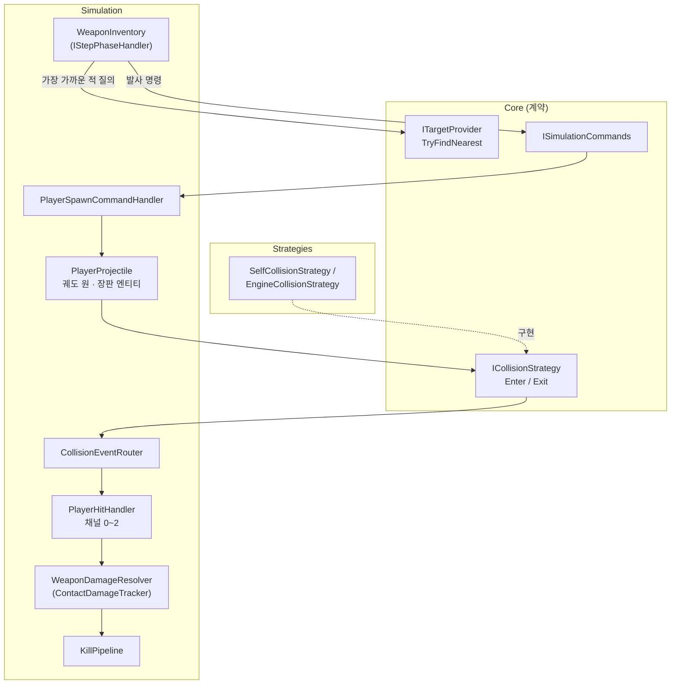
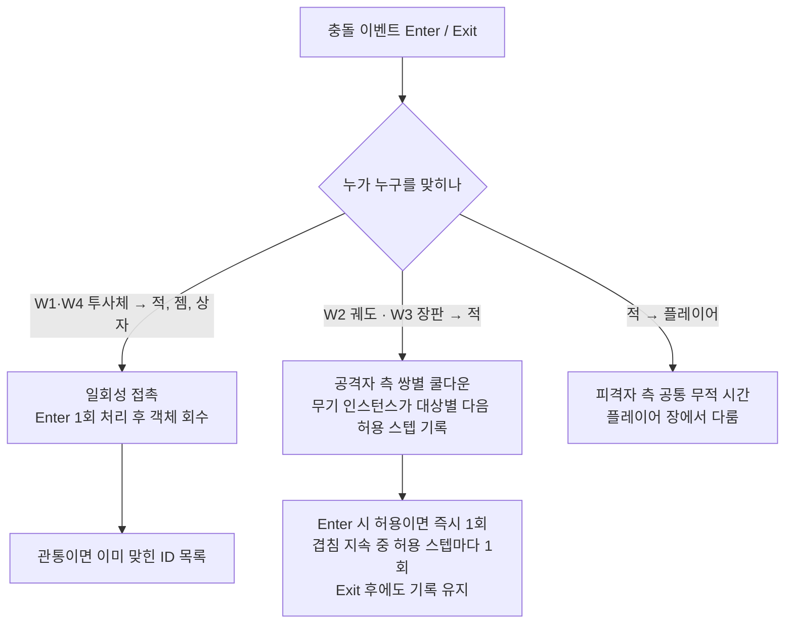
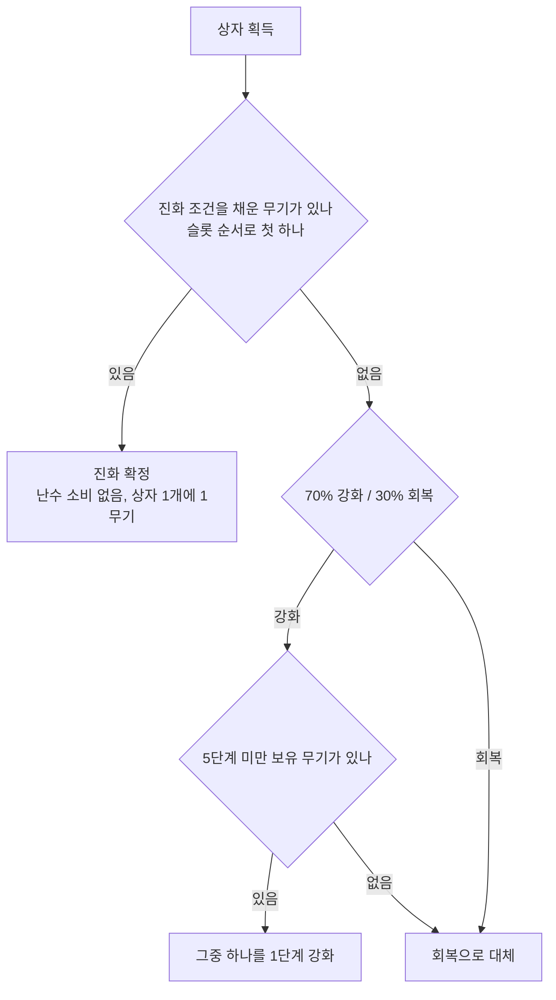

# 프로젝트 명세서 — 뱀서라이크 1차 MVP (무기 부분 발췌)

| 구분 | 내용 |
|---|---|
| 과정 | 개인 프로젝트 (포트폴리오) |
| 회차 | 3회차 — 충돌·플레이어·몬스터 (무기 부분 발췌: F2 자동 공격 · F6 무기 시스템 · F7 조합) |
| 기준 | PRD(동결) · SPEC 6회차 · TECH_SPEC 5회차 · RUN_LOG 2026-10-27 |
| 독자 | 학습용 상세판 (미래의 나 · 지금의 나) |
| 상태 | 샘플 (양식 검증용) |

> 원천을 고치지 않는 파생 문서다. SPEC·TECH가 개정되면 "기준" 행과 본문을 재동기화한다.

## 목차

- [1.1 목표](#11-목표)
- [1.2 준비사항](#12-준비사항)
  - [1) 프로젝트 구조](#1-프로젝트-구조)
  - [2) 사용 데이터](#2-사용-데이터)
  - [3) 개발언어 및 툴](#3-개발언어-및-툴)
  - [4) 필수 라이브러리](#4-필수-라이브러리)
- [1.3 작업 순서](#13-작업-순서)
- [1.4 요구사항](#14-요구사항)
  - [기능적 요구사항](#기능적-요구사항)
  - [1. 기본 기능 (필수)](#1-기본-기능-필수): F2 자동 공격 · F6 무기 시스템 · F7 조합(진화)
  - [2. 심화 기능 (선택)](#2-심화-기능-선택): 관통 투사체
  - [규칙 명세](#규칙-명세) · [인터페이스 명세](#인터페이스-명세) · [수치표](#수치표) · [열린 항목](#열린-항목)
- [1.5 참고자료](#15-참고자료)
- [1.6 프로젝트 결과](#16-프로젝트-결과)

## 1.1 목표

- 무기가 입력 없이 스스로 쏘고, "가장 가까운 적"은 `ITargetProvider` 하나로만 묻는 상태가 되어 있다 (SPEC F2, TECH TAC-F2-4)
- 무기 4종(W1 투사체·W2 궤도·W3 장판·W4 유도)이 `weapons.json` 정의대로 동작하고 5단계까지 강화된다 (SPEC F6, TECH TAC-F6-1~9)
- 피해가 일회성 접촉 / 공격자 측 쌍별 쿨다운으로만 들어가고, 충돌 전략은 Enter·Exit만 알려 준다 (SPEC 3.0 I, TECH 5.12)
- 상자를 먹을 때에만 W1·W2가 E1·E2로 진화하며, 규칙은 `combinations.json`에서 읽는다 (SPEC F7, TECH TAC-F7-1~3)

## 1.2 준비사항

### 1) 프로젝트 구조

이 회차 중 무기 경로만 그린다. 전체 구조는 `docs/architecture.md`를 본다. 그림의 이름은 모두 TECH 5.0.1·5.12에 있는 것이다.

<그림 1> 무기 경로 구조 (웨이브 3 중 무기 부분)

① 무기 보유와 발사 판단 — `WeaponInventory`가 `IStepPhaseHandler`로 스텝마다 각 무기의 쿨다운(`_nextFireStep`)을 보고 발사를 결정한다.
- 근거: 시작 무기가 W1인 것은 무기 없이는 적을 못 죽여 첫 레벨업이 오지 않기 때문이다 (RUN_LOG 2026-10-10 Q7). 무기 4종은 측정 축의 부하원과 1:1로 연결해 골랐다 (RUN_LOG 2026-10-10 라운드 3).

② 타깃 질의 — 무기는 `ITargetProvider.TryFindNearest`만 호출한다. 구현 3종은 같은 결과를 내야 한다.
- 근거: 이 호출이 곧 타깃 탐색 전략(F16)의 측정 부하라서 구현 클래스를 직접 참조하지 못하게 했다. Simulation에는 Strategies 참조가 없어 어기면 컴파일이 안 된다 (TECH TAC-F2-4).

③ 발사·생성 명령 — 무기는 엔티티를 직접 만들지 않고 `ISimulationCommands`에 명령을 넣는다. `PlayerSpawnCommandHandler`가 같은 스텝의 생성 단계에서 `PlayerProjectile`·궤도 원·장판을 만든다.
- 근거: 모든 무기 산출물이 같은 스텝 생성 단계에서 만들어지므로 충돌 전략 A·B에서 첫 피해 스텝이 같다 (TECH TAC-F6-8).

④ 무기 모양 = 원 — 투사체·궤도 원·장판 모두 원이라 판정이 원-원 함수 하나(R5)로 끝난다.
- 근거: 충돌 판정 다섯 쌍을 전부 자체 구현으로 확정할 때 "무기 모양을 우리가 정하니 원으로 한다"가 근거였다 (RUN_LOG 2026-10-12 Q23 재수정). 반지름 하나가 판정 크기와 터널링 불변식(`속도/60 ≤ 반지름`, Q35)을 함께 정한다.

⑤ 충돌 이벤트 전달 — `ICollisionStrategy`는 새로 겹친 스텝(Enter)과 끝난 스텝(Exit)만 보고하고, `CollisionEventRouter`가 `PlayerHitHandler`(채널 0~2)에 넘긴다.
- 근거: 충돌 구현이 둘(엔진 콜백, 자체 폴링)이라 이벤트 종류를 Enter·Exit로 통일해야 "누가 언제 얼마를 받았는가" 로직이 하나로 유지된다. 이것이 전략 동등성 검증(E1)의 전제다 (RUN_LOG 2026-10-16 Q41).

⑥ 피해 적용 — `WeaponDamageResolver`가 `ContactDamageTracker`로 W2·W3의 쌍별 쿨다운 피해를 계산하고, 체력이 0 이하가 되면 `KillPipeline`이 처치를 1회 처리한다.
- 근거: 겹쳐 있는 동안에는 이벤트가 없으므로 지속 접촉 무기는 무기 인스턴스가 대상별 다음 허용 스텝을 들고 있어야 한다 (RUN_LOG 2026-10-16 Q41).

⑦ 진화 경로(그림 밖) — 상자 획득 시 `PlayerProgressionApplier.ApplyEvolution`이 슬롯의 원본을 결과 무기로 교체한다. 상자 경유로 정한 이유는 F7 블록에 쓴다.

### 2) 사용 데이터

<표 1> `weapons.json` 공통 필드 — WeaponDef (출처: TECH_SPEC 5.13.1)

| 필드 | 타입 | 필수 | 의미 · 제약 |
|---|---|---|---|
| `id` | string | 필수 | 고유 ID (`W1`, `E1` 등) |
| `displayName` | string | 필수 | 한국어 표시명 |
| `behavior` | string enum | 필수 | `projectile` / `homing` / `orbit` / `zone`. W4는 `homing`으로만 표현한다 |
| `assetKey` | string | 필수 | 투사체·궤도 원·장판의 시각 키 |
| `iconKey` | string | 선택 | 선택지 UI 아이콘 키 (없으면 `assetKey`) |
| `evolvedOnly` | bool | 선택(기본 false) | true면 진화로만 얻는다. 선택지·상자 강화에서 제외, `levels` 길이는 정확히 1 |
| `levels` | WeaponLevel[] | 필수 | 기본 무기는 정확히 5개, 진화 무기는 정확히 1개. i번째 = (i+1)단계의 절대값 |

<표 2> WeaponLevel 행동 타입별 필드 (출처: TECH_SPEC 5.13.1)

| 필드 | 단위 → 로드 후 | projectile | homing | orbit | zone |
|---|---|---|---|---|---|
| `damage` | 피해량 (> 0) | 필수 | 필수 | 필수 | 필수 |
| `cooldownSeconds` | 초 → 스텝(최소 1) | 필수 | 필수 | - | 필수(생성 주기) |
| `projectileCount` | 개 (≥ 1) | 선택(1) | 선택(1) | - | - |
| `spreadDegrees` | 도 (≥ 0) | 선택(0) | 선택(0) | - | - |
| `projectileSpeed` | 유닛/초 → 유닛/스텝 | 필수 | 필수 | - | - |
| `projectileRadius` | 유닛 | 필수 | 필수 | - | - |
| `lifetimeSeconds` | 초 → 스텝(최소 1) | 필수 | 필수 | - | - |
| `pierceCount` | 회 (≥ 0) | 선택(0) | 선택(0) | - | - |
| `orbCount` | 개 (≥ 1) | - | - | 필수 | - |
| `orbRadius` | 유닛 | - | - | 필수 | - |
| `orbitRadius` | 유닛 | - | - | 필수 | - |
| `angularSpeedDegPerSec` | 도/초 → 라디안/스텝 | - | - | 필수 | - |
| `hitIntervalSeconds` | 초 → 스텝(최소 1), W2·W3 피해 틱 간격 | - | - | 필수 | 필수 |
| `zoneRadius` | 유닛 | - | - | - | 필수 |
| `durationSeconds` | 초 → 스텝(최소 1) | - | - | - | 필수 |
| `placement` | `nearestEnemy` / `player` | - | - | - | 선택(`nearestEnemy`) [Q8] |

행동 타입에 해당하지 않는 필드는 알 수 없는 키처럼 Warning 후 무시한다.

<표 3> `combinations.json` 필드 (출처: TECH_SPEC 5.13.3, 선택 파일)

| 필드 | 타입 | 제약 |
|---|---|---|
| `id` | string | 필수 |
| `weaponId` | string | 필수. `evolvedOnly == false`인 유효 무기 |
| `passiveId` | string | 필수. 유효 패시브 |
| `resultWeaponId` | string | 필수. `evolvedOnly == true`인 유효 무기 |

같은 `weaponId`를 쓰는 규칙이 둘이면 둘째를 건너뛴다(Warning). 패시브 파일이 없으면 모든 규칙이 참조 오류로 건너뛰어진다.

### 3) 개발언어 및 툴

- Unity 6000.3 (URP 2D), C# (TECH 5b: Unity 6000.3.26f1, Universal 2D 템플릿)

### 4) 필수 라이브러리

- Newtonsoft.Json (TECH 5b: D17 확정)
- TextMeshPro Essentials (TECH 5b: Essential Resources 가져오기)

## 1.3 작업 순서

1. 선행 조건을 확인한다: 웨이브 2 조립 완료(공간 인덱스, 생명주기·명령 버퍼, 정의 객체). COLLISION은 U5·U7·U8·U30·U32 실측 결과가 필요하다 (TECH 5c.4 웨이브 3).
2. TAC-F2: 시작 무기 W1 보유, `_nextFireStep` 쿨다운, `ITargetProvider`(`StepContext.Targets`) 호출, `WeaponsEnabled` 주입값을 구현한다.
3. TAC-F2-3·F6-7: 유효 쿨다운(`StatMath.ApplyAttackSpeed`)과 단계별 절대값 `levels[level-1]` 적용을 구현한다.
4. TAC-F6-1~3·9: `WeaponFactory`와 `ProjectileWeapon`(W1·E1·W4 재조준 모드)을 구현하고 채널 0 Enter 1회 피해와 `Consumed` 처리를 붙인다.
5. TAC-F6-4·5·8: `OrbitWeapon`(스텝 번호 기반 위치, 상시 존재, 원 수 보정)과 `ZoneWeapon`(가장 가까운 적 위치, 적이 없으면 재시도)을 구현한다.
6. TAC-F6-6: `ContactDamageTracker`와 `WeaponDamageResolver`로 W2·W3 쌍별 쿨다운 피해를 구현한다.
7. TAC-F7: `TryFindFirstEligible()`과 `ApplyEvolution`(같은 슬롯 교체)을 구현하고 `combinations.json` 부재 시 빈 목록으로 처리한다.
8. 테스트: EditMode(각 TAC의 EM 표시) + PlayMode(E1·E2 하네스 골격)로 마무리한다.

## 1.4 요구사항

이 회차의 요구사항은 3회차(충돌·플레이어·몬스터) 중 무기에 해당하는 F2·F6·F7뿐이다. 몬스터 본체와 충돌 전략 본문은 다루지 않고 참조만 한다. 읽는 순서는 기능적 요구사항 표 → 기능별 상세 → 규칙·인터페이스·수치표 → 열린 항목이다. 상세 안의 `[해설]`은 원천에서 읽어 낸 작성자 해석이다.

### 기능적 요구사항

<표 4> 기능적 요구사항

| 번호 | 분류 | 요구사항명 | 요구사항 상세 | 우선순위 |
|---|---|---|---|---|
| F2-1 | 기능 | 시작 무기 | 시작 시 W1 1단계를 보유한다. 무기 없이는 적을 죽일 수 없어 첫 레벨업이 불가능하기 때문이다. | 필수 |
| F2-2 | 기능 | 쿨다운 발사 | 무기마다 독립된 `_nextFireStep`을 가지고, `step ≥ _nextFireStep`이고 무기 활성화가 켜져 있고 타깃이 있으면 발사한다. | 필수 |
| F2-3 | 기능 | 타깃 질의 | 가장 가까운 적은 `ITargetProvider`로만 묻는다. 적이 없으면 발사하지 않고 오류도 없다. | 필수 |
| F2-4 | 기능 | 피해 적용 방식 | 피해는 일회성 접촉 또는 공격자 측 쌍별 쿨다운으로만 적용되고 같은 접촉에서 매 스텝 중복되지 않는다. | 필수 |
| F6-1 | 기능 | W1 투사체 | 발사 순간 가장 가까운 적 방향을 한 번 정해 직진하고, 적 1기와 첫 Enter에서 피해를 준 뒤 소멸한다. | 필수 |
| F6-2 | 기능 | W2 근접 회전 | 궤도 원 `orbCount`개가 플레이어 주변을 돌며 보유하는 동안 상시 존재한다(수명 없음). | 필수 |
| F6-3 | 기능 | W3 장판 | 쿨다운마다 가장 가까운 적 위치에 원형 장판을 만들고 지속시간 뒤 회수한다. 적이 없으면 생성도 쿨다운 소비도 없다. | 필수 |
| F6-4 | 기능 | W4 유도 투사체 | 매 스텝 투사체 자신의 위치에서 가장 가까운 적으로 방향을 갱신하고, 적이 없으면 마지막 방향으로 직진한다. | 필수 |
| F6-5 | 기능 | 지속 접촉 피해 | W2·W3는 무기 인스턴스가 대상별 다음 허용 스텝을 기록한다. Enter 시 허용이면 즉시 1회, 겹침 중 허용 스텝마다 1회 준다. | 필수 |
| F6-6 | 기능 | 쿨다운 기록 유지 | Exit 뒤에도 허용 스텝까지 기록을 유지하고, 키는 세대가 붙은 `EntityId`다. | 필수 |
| F6-7 | 데이터 | 강화 5단계 | `levels[i]`는 (i+1)단계의 절대값 전체 집합이며 5단계가 최대다. | 필수 |
| F6-8 | 기능 | 슬롯 | 무기는 최대 4개이고 같은 무기를 두 번째 슬롯에 둘 수 없다(선택 시 강화로만 처리). | 필수 |
| F6-9 | 데이터 | 에셋 키 참조 | 무기 코드는 에셋을 문자열 키로만 참조하고, 투사체·장판의 생성·회수는 풀 전략(F9)을 거친다. | 필수 |
| F7-1 | 기능 | 상자 경유 진화 | 조건(무기 5단계 + 패시브 보유)을 채워도 상자를 먹어야 진화한다. 효과는 확정이다. | 필수 |
| F7-2 | 기능 | 슬롯 교체 | 같은 슬롯 인덱스에서 원본을 결과 무기 1단계로 교체한다. 슬롯 수는 불변이다. | 필수 |
| F7-3 | 기능 | 동시 충족 | 조건을 채운 무기가 둘이면 상자 1개에 하나, 슬롯 번호가 작은 쪽부터 진화한다. | 필수 |
| F7-4 | 데이터 | 조합 규칙 파일 | 규칙은 `combinations.json`에서 읽고, 파일이 없으면 진화만 동작하지 않는다. | 필수 |
| F6-10 | 데이터 | 관통 투사체 | `pierceCount > 0`인 투사체는 이미 맞힌 ID 목록으로 재피해를 막고 `pierceCount + 1`회째 명중에서 소멸한다. | 심화 |

### 1. 기본 기능 (필수)

#### F2. 자동 공격

① 요구사항 번호: F2 (SPEC F2)
② 상세: 장착한 무기는 입력 없이 자동으로 공격한다. 모든 무기는 자기만의 `_nextFireStep`을 가지며, 발사 조건은 `현재 스텝 ≥ _nextFireStep`, 무기 활성화 규칙 on, 타깃 있음 세 가지다. 발사하면 `_nextFireStep = 현재 스텝 + 유효 쿨다운`으로 갱신한다.
③ 타깃이 없으면 발사하지도 `_nextFireStep`을 건드리지도 않고 다음 스텝에 다시 시도한다. 여러 무기는 각자 독립된 쿨다운을 가진다. 쿨다운은 실수 시간이 아니라 스텝 번호이고 일시정지·레벨업 선택 중에는 스텝이 돌지 않아 쿨다운도 진행되지 않는다.
④ `ITargetProvider`는 무기가 "지금 가장 가까운 몬스터가 누구인가"를 묻는 유일한 창구다. `TryFindNearest(point, out hit)`가 핵심이고 몬스터가 없으면 예외 없이 `false`다. 구현은 전수 순회·공간 해시·`Physics2D` 쿼리 세 가지이며 결과가 같아야 한다. 같음의 기준은 제곱거리가 작은 쪽, 같으면 `EntityId`가 작은 쪽(R6)이다. 질의 대상은 그 스텝 초반에 얼린 몬스터 위치 스냅샷이다.
- 유효 쿨다운은 `max(1, round(기본 스텝 / (1 + 보너스)))`다(R13). P1이 어디에 걸리는지는 열린 항목에 둔다. 기본값(TECH D14)은 W1·W3·W4의 쿨다운과 W2의 틱 간격에 적용하고 W3 장판 내부 틱 간격에는 적용하지 않는 것이다. 적 → 플레이어 피해의 무적 시간은 다른 회차(플레이어 장)의 몫이다.
- 근거: 무기가 매 스텝 "가장 가까운 적"을 묻는 호출이 곧 타깃 탐색 전략(F16)의 측정 부하라서 무기 코드는 `ITargetProvider`만 호출한다. 구현 클래스를 직접 참조하면 어셈블리 참조가 없어 컴파일이 안 된다. 타깃 탐색 전략을 바꿔도 어떤 적을 고르는지는 같아야 하므로 R6 타이브레이크를 공유하고, 이 동등성이 F10 전/후 측정의 전제다.
◆ 제약: 공격 on/off는 `SimulationRules.WeaponsEnabled` 주입값으로만 제어하며 F2 코드에 개발자 모드 분기를 두지 않는다. 몬스터가 플레이어를 쫓는 일에는 `ITargetProvider`를 쓰지 않는다(플레이어 위치를 직접 읽는다).
◆ 원천: SPEC F2, F5 마지막 항, F16, 3.0 B / TECH TAC-F2-1~6, 5.7, R6 / RUN_LOG 2026-10-10 (Q7, 타깃 탐색 전략), 2026-10-12 (Q21 결정론)
◼ 동작 예: W1 1단계를 든 플레이어 주변에 적 셋이 있다.
- 허용 스텝이 되면 무기가 `ITargetProvider`에 플레이어 위치에서 가장 가까운 적을 묻고, 거리가 같으면 ID가 작은 적이 답이다.
- 무기는 그 방향으로 생성 명령을 넣고, 같은 스텝의 생성 단계에서 투사체가 나타난다. 발사 후 방향은 바뀌지 않는다.
- 투사체는 적과 처음 겹친 스텝(Enter)에 피해를 주고 그 자리에서 회수된다. 체력이 0 이하가 되면 처치 처리로 넘어간다.
- 아무와도 만나지 못한 투사체는 수명이 끝나면 조용히 사라진다.

⑤ 예외와 엣지

<표 5> F2 예외와 엣지

| 상황 | 동작 | 근거 |
|---|---|---|
| 적이 없을 때 W1 | 발사하지 않고 오류도 없다. `_nextFireStep`을 바꾸지 않아 적이 생긴 첫 스텝에 바로 발사 | F2, TAC-F2-2 |
| 적이 없을 때 W4 | 새 투사체를 발사하지 않는다. 이미 날고 있는 투사체는 마지막 방향으로 직진하다 수명이 끝나면 소멸 | F2, F6, Q9 |
| 일시정지·레벨업 선택 중 | 스텝이 돌지 않으므로 쿨다운·투사체·궤도 모두 정지 | F2 |

#### F6. 무기 시스템

① 요구사항 번호: F6 (SPEC F6)
② 상세: 무기 4종을 정의 데이터대로 구현하고 획득과 5단계 강화를 지원한다. 네 종은 투사체·궤도·장판·유도라는 서로 다른 피해 적용 방식을 하나씩 맡는다. 무기 모양은 전부 원이고 모든 무기 로직은 고정 스텝에서 실행한다. 무기는 `behavior` 값으로 `WeaponFactory`가 만들며, W4를 나타내는 방법은 `behavior: "homing"` 하나뿐이다.

<표 6> 무기별 생애 (출처: SPEC F6 무기 표·3.0 I, TECH TAC-F6-1~9)

| 무기 | 생성 | 이동 | 명중 | 소멸/회수 |
|---|---|---|---|---|
| W1 (E1) | 쿨다운이 되고 적이 있을 때 발사 명령, 같은 스텝 생성 단계 | 발사 순간 정한 방향으로 직진 | 첫 Enter에 피해 1회 | 명중 즉시 회수, 또는 수명 만료 |
| W2 (E2) | 무기 획득·강화·진화 직후 모자란 원을 생성, 이후 상시 | 플레이어 주변을 스텝 번호로 계산한 각도로 회전 | Enter 즉시 + 틱 간격마다 | 수명 없음. 진화 교체·초과분·런 종료 때만 회수 |
| W3 | 쿨다운이 되고 적이 있을 때 가장 가까운 적 위치에 | 정지 | Enter 즉시 + 틱 간격마다 | 지속시간 만료 시 수명 만료 단계에서 회수 |
| W4 | W1과 같은 경로, 재조준 모드 | 매 스텝 자기 위치 기준으로 방향 갱신 | 첫 Enter에 피해 1회 | 명중 즉시 회수, 또는 수명 만료 |

③ 강화와 슬롯: 무기는 최대 4개, 패시브는 최대 3개를 가지고 각각 5단계까지 올린다. `levels[i]`는 증분이 아니라 통째로 갈아 끼우는 절대값이며 6단계 이상은 없다. 새 무기를 고르면 가장 앞의 빈 슬롯에 1단계로 들어가고, 이미 가진 무기를 고르면 강화로 처리된다. 상자 효과 ②에서는 5단계 미만인 보유 무기를 슬롯 순서로 나열해 하나를 뽑아 1단계 올린다. 슬롯 번호는 진화 순서, 상자 강화 대상 목록 순서, 같은 스텝의 지속 피해 계산 순서에 모두 쓰인다.
④ 피해 적용: 충돌 전략은 Enter·Exit만 보고하고, "누가 겹쳐 있는가, 언제 피해를 주는가"는 전략과 무관한 게임 로직 하나가 전담한다.
- W1: 발사 순간 가장 가까운 적 쪽 방향을 한 번 정하고(영벡터면 오른쪽, `DirectionOrDefault`) 이후 바꾸지 않는다. 사거리 제한은 없고 수명(스텝)이 끝나면 사라진다. 4~5단계는 `projectileCount`가 2라서 같은 스텝에 여러 개가 나가며 `spreadDegrees`를 균등 분할한다.
- W2: 원 `orbCount`개가 `orbitRadius`에서 돈다. i번째 원의 위치는 `플레이어 위치 + R·(cosθ_i, sinθ_i)`, `θ_i = θ0 + ω·스텝 + 2π·i/orbCount`로, 스텝 번호에서 직접 계산해 오차가 누적되지 않는다. 회수는 진화 교체, 단계가 바뀌어 `orbCount`가 줄었을 때의 초과분(인덱스가 큰 것부터), 런 종료·재시작 셋뿐이다(핫 리로드는 보유 인스턴스에 적용되지 않으므로 해당 없음). `lifetimeSteps = 0`을 "수명 없음"으로 읽어 `LifetimeSystem`이 건너뛴다.
- W3: 쿨다운이 되면 가장 가까운 적의 위치(Q8 기본값)에 반지름 `zoneRadius`의 장판을 만든다. 적이 없으면 장판도 쿨다운 소비도 없이 다음 스텝에 재시도한다(Q46 ②). 장판은 생성 스텝부터 `durationSeconds` 뒤 수명 만료로 회수된다. 생성 스텝에는 피해가 없고 첫 피해는 "발사 스텝 + 1"이다.
- W4: W1과 같은 `ProjectileWeapon` 경로에서 나오되 투사체가 재조준 모드다. 매 스텝 자기 위치에서 가장 가까운 적을 다시 찾는다. 추적하던 적이 죽거나 사라지면 다음 스텝의 재탐색이 새 가장 가까운 적을 고른다. 적이 없으면 마지막 방향으로 직진하고 수명이 끝나면 소멸한다(Q9). 사거리 제한은 없고 첫 Enter에서 피해를 주고 소멸한다.

[해설] W1과 W4는 "작은 원이 날아가 적 1기를 맞히고 사라진다"는 점은 같고, 차이는 재조준 기준점이다. 재조준 기준이 플레이어가 아니라 투사체 자신의 위치이므로 W4는 "처음 고른 적을 끝까지 쫓는 무기"가 아니다. 스키마상 두 무기의 차이는 `behavior` 값 하나와 수치표의 값뿐이다.

<표 7> [해설] W1과 W4 비교 (출처: 위 W1·W4 규칙을 작성자가 풀어 쓴 것)

| 구분 | W1 | W4 |
|---|---|---|
| 방향 결정 | 발사 순간 1회, 이후 고정 | 매 스텝 갱신 |
| 재조준 기준점 | 해당 없음 (발사 때만 플레이어 위치 기준) | 투사체 자신의 현재 위치 |
| 적중률 | 대상이 움직이면 빗나갈 수 있음 | 날아가는 도중 방향을 고쳐 추격 |
| 타깃 탐색 호출 | 무기당 발사 1회 | 투사체 수 × 비행 스텝 수 |
| 대상이 죽으면 | 영향 없음 (이미 직진 중) | 다음 스텝에 새 가장 가까운 적으로 교체 |

<그림 2> 피해가 적용되는 세 가지 방식 (SPEC 3.0 I)

- 근거: 궤도 원이 적과 겹쳐 있는 시간은 보통 수십 스텝이라 겹침 스텝마다 피해를 주면 초당 60번 맞아 틱 간격이 사라진다. 반대로 이벤트가 올 때만 주면 Enter 한 번에 끝난다. 그래서 무기 인스턴스가 대상 ID별 다음 허용 스텝을 들고 틱 간격마다 한 번씩 준다(`ContactDamageTracker`).
- 근거: 기록은 Exit 뒤에도 허용 스텝까지 유지한다. 지우면 경계를 들락거려 쿨다운을 우회할 수 있다. 대상이 풀로 반납되면 Exit이 오지 않으므로 반납 시 기록을 직접 지우고, 키가 세대 포함 `EntityId`라서 같은 인덱스를 물려받은 새 몬스터가 쿨다운을 물려받지 않는다.
- 근거: "겹친 뒤 매 스텝 피해를 어떻게 막는가"라는 질문에서 확정되었다 (RUN_LOG 2026-10-16 Q41). 적이 플레이어를 때리는 쪽은 피격자 측 공통 무적 시간을 쓰며 다른 회차의 몫이다.

- 보충(W1 "명중 시 소멸"): 규칙은 하나다. W1·W4 투사체는 적과의 첫 Enter에서 피해를 주고 소멸한다(관통 없음). SPEC 3.0 I이 "일회성 접촉" 분류로 정하고 TECH TAC-F6-9가 채널 0 Enter 1회 피해 → `Consumed` 표시 → 회수 명령으로 구현을 정한다. 같은 스텝의 다른 Enter는 `Consumed`라 무시한다.
- 보충(W2·W3 틱): 틱 간격은 무기 JSON의 초 단위 필드이며 로드 시 스텝으로 환산된다.
- 보충(전략 동등성): 충돌 전략을 바꿔도 피해 결과가 같아야 한다. 전략이 달라지는 것은 비용뿐이다.

◆ 제약: W2 궤도와 W3 장판은 `Collider2D`에 의존하지 않고 자체 원-원 판정 대상이어야 한다. 무기 코드는 프리팹·스프라이트를 직접 참조하지 않는다.
◆ 원천: SPEC F6(4회차·6회차 기준), 3.0 I, F18 / TECH TAC-F6-1~9, 5.10 `Spawn<T>`, 5.12, R5 / RUN_LOG 2026-10-10 (라운드 3, Q8, Q9), 2026-10-12 (Q23 재수정, Q35 불변식), 2026-10-16 (Q41, D13, Q46 ②), 2026-10-21 (W4 표기 보강, 궤도 원 상시 존재)
◼ 동작 예: W2·W3를 들고 적 무리 속을 지난다.
- W2 궤도 원은 무기를 얻은 순간부터 돌고, W3는 쿨다운이 되면 가장 가까운 적의 위치(플레이어 위치가 아니다)에 장판을 깐다.
- 궤도 원이 적과 겹치는 순간(Enter) 허용 상태이면 즉시 1회 피해를 주고, 겹침이 이어지면 틱 간격마다 한 번씩 더 준다.
- 적이 밀려났다가 틱 간격 안에 재진입해도 Exit 뒤 "다음 허용 스텝" 기록이 남아 있어 추가 피해는 없다. 장판 위의 적도 같은 규칙이다.

⑤ 예외와 엣지

<표 8> F6 예외와 엣지

| 상황 | 동작 | 근거 |
|---|---|---|
| 적이 없을 때 W3 | 장판 생성도 쿨다운 소비도 없이 다음 스텝에 재시도 | F6, Q46 ②, TAC-F6-5 |
| 추적 중 대상이 죽었을 때 (W4) | 다음 스텝의 재탐색이 새 가장 가까운 적을 고른다. W1은 방향이 이미 고정이라 영향 없음 | F6, TAC-F6-3 |
| 같은 스텝에 한 투사체가 둘에 겹칠 때 | 정렬 순서상 앞(작은 몬스터 ID)만 맞힌다. 나머지는 `Consumed`라 무시 | TECH 5.12 |
| 이미 hp ≤ 0인 몬스터에 같은 스텝 추가 피해 | 무시. 처치 처리는 1회 | TECH 5.12 |
| W2·W3 영역을 들락거릴 때 | Exit 후에도 허용 스텝까지 기록 유지, 재진입해도 틱 간격 안이면 피해 없음 | 3.0 I, F6 |
| 같은 무기의 장판 여러 개가 한 적에 겹칠 때 | 그 무기의 기록 하나로 센다. 겹친 장판 수만큼 맞지 않음 | TAC-F6-6 |
| 서로 다른 무기(W2와 W3)가 한 적에 겹칠 때 | 추적 기록은 무기 인스턴스마다 하나이므로 각자의 틱으로 따로 맞는다 | TECH 5.12 |
| 슬롯이 꽉 찼을 때 선택지 | 무기 4개가 차면 "새 무기" 선택지가 풀에서 제외된다. 보유 무기의 강화는 그대로 나올 수 있다 | F5, TAC-F5-3 |
| 이미 가진 무기를 선택했을 때 | 두 번째 슬롯에 넣을 수 없고 강화로만 처리된다 | F6 |
| 5단계 무기 / 진화 무기 | 강화 선택지에서 제외. 진화 무기는 상자 강화에서도 제외 | F5, F4, F7 |
| 모든 보유 무기가 5단계거나 강화 가능한 무기가 없는데 상자 ②에서 강화가 나왔을 때 | 회복으로 대체 | F4 |

#### F7. 조합(진화)

① 요구사항 번호: F7 (SPEC F7)
② 상세: 진화 조건을 채운 상태에서 상자를 획득하면 무기가 진화 무기로 교체된다. 조건을 채웠다고 자동으로 진화하지 않는다. 조건은 무기 5단계 + 패시브 보유(패시브 단계 무관)다.

<표 9> 진화 조합 (출처: SPEC F7, TECH_SPEC 5.13.3)

| 진화 | 재료 | 결과 | 조건 |
|---|---|---|---|
| E1 | W1 + P1 | 연사 투사체 | W1이 5단계 + P1 보유 (패시브 단계 무관) |
| E2 | W2 + P3 | 확대 궤도 | W2가 5단계 + P3 보유 (패시브 단계 무관) |

③ 상자 효과: 상자를 먹으면 아래 순서로 효과가 결정된다.

<그림 3> 상자 효과 결정 순서

④ 교체 방식: 진화는 같은 슬롯 인덱스에서 원본 인스턴스를 결과 무기 1단계 인스턴스로 교체한다. 슬롯 수는 변하지 않고 원본은 남지 않는다. 원본의 자식(궤도 원·장판)은 같은 스텝에 회수되고 결과 무기의 자식은 다음 스텝부터 생성된다. 진화한 뒤 다시 진화하지 않는다. 결과 무기는 `evolvedOnly`라 레벨업 선택지와 상자 강화에서 항상 제외되고, 진화로 소모된 원본 무기의 "새로 얻기" 선택지도 제외된다(TECH D5 기본값).
- E1은 W1 5단계보다 짧은 쿨다운과 많은 `projectileCount`를, E2는 W2 5단계보다 큰 `orbitRadius`·`orbRadius`를 갖는다. 진화 관계 자체는 `combinations.json`에만 있고, 이 파일이 없으면 진화만 동작하지 않고 게임은 계속된다.
- 보충(다른 회차): 진화 재료 P3(획득 범위)와 P1의 정의는 플레이어 장의 몫이다.
- 근거: 처음에는 조건만 채우면 자동 진화였다. 상자가 한 판에 30~50개 나온다는 추정과 함께 "자동 진화는 수백 마리가 깔린 화면에서 조용히 일어나 눈치채기 어렵지만, 상자 경유는 진화에 획득 순간을 만든다"는 점이 채택 이유가 되었다 (RUN_LOG 2026-10-12 Q10 재수정, Q5 우선순위). 진화 무기가 추가 강화를 갖지 않는 것은 Q30, 동시 충족 시 슬롯 번호가 작은 쪽 먼저는 Q42(기본값 채택)다.
◆ 제약: 슬롯 번호 순서로 훑어 첫 자격 규칙만 진화시킨다(`TryFindFirstEligible()`).
◆ 원천: SPEC F7, F4 / TECH TAC-F7-1~3, TAC-F4-4, 5.14 / RUN_LOG 2026-10-12 (Q10, Q5, Q30, Q42)

⑤ 예외와 엣지

<표 10> F7 예외와 엣지

| 상황 | 동작 | 근거 |
|---|---|---|
| 진화 직후 궤도 원 | E2 진화 시 W2의 원은 같은 스텝에 회수되고 E2의 원은 다음 스텝 무기 처리부터 생성된다. 슬롯과 슬롯 수는 불변 | TAC-F7-2, TAC-F6-8 |
| 조건을 채운 무기가 둘일 때 | 상자 1개에 하나, 슬롯 번호가 작은 쪽 먼저 | F7, Q42 |

### 2. 심화 기능 (선택)

이 회차에서 심화에 해당하는 것은 데이터만으로 여는 확장인 관통 투사체 하나다. 기본 무기 네 종은 모두 관통이 0이다.

#### 관통 투사체 (데이터 확장)

① 요구사항 번호: F6-10 (SPEC F6 4회차 신규)
② 상세: `pierceCount`(기본 0)가 0보다 크면 투사체는 "이미 맞힌 ID 목록"(세대 포함 `EntityId`)으로 같은 적을 두 번 때리지 않고 `pierceCount + 1`번째 명중에서 소멸한다. JSON으로 새 무기를 추가할 때만 의미가 있다.
◆ 원천: SPEC F6 4회차 신규 기준 / TECH TAC-F6-9, 5.13.1 `pierceCount`

### 규칙 명세

<표 11> 규칙 명세 (출처: TECH_SPEC 5a)

| 번호 | 분류 | 규칙명 | 규칙 상세 (보장하는 함수) | 관련 요구사항 |
|---|---|---|---|---|
| R1 | 단위 | 초 → 스텝 환산 | `Round(초 × 60)`(0.5는 올림). 무기의 쿨다운·수명·틱 간격·지속시간은 최소 1스텝. 음수·NaN·∞는 예외 (`StepMath.SecondsToSteps`, `StepMath.SecondsToIntervalSteps`) | F2, F6 |
| R3 | 단위 | 속도 단위 | JSON은 유닛/초, 런타임은 유닛/스텝(값 / 60). 각속도는 도/초에서 라디안/스텝으로 (`StepMath.PerSecondToPerStep`, `StepMath.DegPerSecondToRadPerStep`) | F6 |
| R5 | 충돌 | 원-원 겹침 | `(b − a).sqrMagnitude ≤ (ra + rb)²`, 경계 포함, 제곱근 없음 (`CircleMath.Overlaps`, `CollisionChannelTable.TryGetChannel`) | F6 |
| R6 | 탐색 | 최근접 타이브레이크 | 제곱거리가 작은 쪽, 같으면 `EntityId`가 작은 쪽 (`TargetOrdering.IsBetter`) | F2, F6 |
| R10 | 순서 | 결정적 순회 순서 | 순회·피해 적용·처치는 `EntityId` 오름차순, 이벤트·명령도 고정 정렬 (`EntityId.CompareTo`, `CollisionEvent.CompareTo`, `SimulationCommand.Compare`) | F6 |
| R11 | 생명주기 | 엔티티 생성·회수 | 생성·회수는 Lifecycle 단계와 판 리셋에서만, 다른 경로로 `Acquire`/`Release` 등을 호출하지 않는다 (`EntityLifecycle.Spawn`, `EntityLifecycle.Despawn`) | F6 |
| R13 | 보정 | 패시브 보정 | 공격 속도는 `max(1, round(baseSteps / (1 + bonus)))`. W1·W3·W4 쿨다운과 W2 틱 간격에 적용 [기본값 D14] (`StatMath.ApplyAttackSpeed`) | F2, F6 |
| R15 | ID | 객체 ID 형식 | `"{Index}:{Generation}"` 형식을 CSV·로그·쿨다운 기록·타깃 결과에 공통 사용 (`EntityId.ToString`, `EntityId.CompareTo`) | F2, F6 |
| R17 | 이동 | 대각 이동 | 방향이 영벡터면 `Vector2.right`로 대체. W1 발사 방향에 쓰인다 (`MoveMath.ToUnitDirection`, `MoveMath.DirectionOrDefault`) | F2, F6 |
| R22 | 진행 | 강화 가능 판정 | 무기는 `level < levelCount && !evolvedOnly` (`ProgressionRules.IsWeaponUpgradable`) | F6, F7 |

### 인터페이스 명세

<표 12> 인터페이스 명세 (출처: TECH_SPEC 5.0.1, 5.7, 5.12)

| 번호 | 인터페이스 · 메서드 | 어셈블리 | 입력 → 출력 / 오류 | 관련 요구사항 |
|---|---|---|---|---|
| I1 | `ITargetProvider.TryFindNearest(point, out hit)` | Core | 입력 점 → 가장 가까운 몬스터 `TargetHit`(Id·Position·DistanceSquared) / 몬스터가 없으면 `false`, 예외 없음 | F2, F6 |
| I2 | `ISimulationCommands` (구현 `SimulationCommandBuffer`) | Core | 무기가 발사·생성 명령을 적재한다 / 시그니처는 이 문서에서 미확인 | F2, F6 |
| I3 | `ISimulationCommandHandler` 중 `PlayerSpawnCommandHandler` | Simulation | `SpawnPlayerOrb` 등 생성 명령 → `EntityLifecycle.Spawn<T>` / `lifetimeSteps`: 0 = 수명 없음(`ExpireStep = long.MaxValue`), > 0 = SpawnStep + n, < 0 = `ArgumentOutOfRangeException` | F6 |
| I4 | `ICollisionEventHandler` 중 `PlayerHitHandler` | Simulation | 채널 0~2의 Enter/Exit 이벤트 → 피해·회수 명령 / 시그니처는 이 문서에서 미확인 | F6 |
| I5 | `IStepPhaseHandler` 중 `WeaponInventory` | Core 계약, Simulation 구현 | `OnPhase(SimulationPhase phase, in StepContext context)` → 무기 처리(WeaponTick)에서 발사 판단 | F2, F6, F7 |

### 수치표

아래 값은 전부 TECH_SPEC 5.13의 예시 JSON에서 가져온 것이며 확정값이 아니다. 초 단위 값은 로드 시 `스텝 = 반올림(초 × 60)`(0.5는 올림), 최소 1로 환산되고 속도(유닛/초)는 `/60`으로 스텝당 이동량이 된다. 예시 파일은 W2·W3·W4를 1단계만 보였고, 실제 파일에서는 기본 무기가 반드시 5단계를 가진다(아니면 그 정의를 건너뛴다).

<표 13> W1 단계별 값 (출처: TECH_SPEC 5.13 예시값, Q1 밸런싱 대상 — 구현 뒤 weapons.json 현재값으로 교체)

| 단계 | 피해 | 쿨다운(초 → 스텝) | 발사 수 | 퍼짐(도) |
|---|---|---|---|---|
| 1 | 10 | 1.0 → 60 | 1 | 0 |
| 2 | 12 | 0.9 → 54 | 1 | 0 |
| 3 | 14 | 0.8 → 48 | 1 | 0 |
| 4 | 16 | 0.7 → 42 | 2 | 10 |
| 5 | 20 | 0.6 → 36 | 2 | 10 |

모든 단계 공통: 투사체 속도 12유닛/초 → 0.2유닛/스텝, 반지름 0.25, 수명 2.0초 → 120스텝. 최대 비행 거리는 12 × 2.0 = 24유닛(계산값)이다.

<표 14> W2·W3·W4 1단계 값 (출처: TECH_SPEC 5.13 예시값, Q1 밸런싱 대상 — 구현 뒤 weapons.json 현재값으로 교체)

| 무기 | 항목 | 값 (초 → 스텝 환산) |
|---|---|---|
| W2 | 피해 / 궤도 원 수 | 8 / 2 |
| W2 | 원 반지름 / 궤도 반지름 | 0.4 / 2.0 |
| W2 | 각속도 | 180도/초 → 3도/스텝 (한 바퀴 120스텝, 계산값) |
| W2 | 피해 틱 간격 | 0.5초 → 30스텝 |
| W3 | 피해 / 쿨다운 | 6 / 3.0초 → 180스텝 |
| W3 | 반지름 / 지속시간 | 1.5 / 2.0초 → 120스텝 |
| W3 | 피해 틱 간격 | 0.5초 → 30스텝 |
| W4 | 피해 / 쿨다운 | 8 / 1.5초 → 90스텝 |
| W4 | 속도 / 반지름 | 9유닛/초 → 0.15유닛/스텝 / 0.2 |
| W4 | 수명 | 3.0초 → 180스텝 (최대 비행 거리 9 × 3.0 = 27유닛, 계산값) |

<표 15> E1 값 (출처: TECH_SPEC 5.13 예시값, Q1 밸런싱 대상 — 구현 뒤 weapons.json 현재값으로 교체)

| 항목 | 값 (초 → 스텝 환산) |
|---|---|
| 피해 | 22 |
| 쿨다운 | 0.2초 → 12스텝 (W1 5단계는 36스텝) |
| 발사 수 / 퍼짐 | 3 / 12도 |
| 속도 / 반지름 | 14유닛/초 → 약 0.233유닛/스텝 / 0.25 |
| 수명 | 2.0초 → 120스텝 |

E2는 예시 JSON에 값이 없다 (열린 항목 참조).

### 열린 항목

- 게임 시작 직후 W1의 첫 `_nextFireStep` 값 (개발자 무기 구성 설정에는 "현재 스텝"이라고 적혀 있다) — 닫히는 곳: SPEC F2 또는 TECH TAC-F2
- 진화 직후 E1/E2의 첫 발사 시각 — 닫히는 곳: TECH TAC-F7-2
- W3의 `placement`가 `player`일 때 대상이 없는 경우의 동작 (스키마에 열거값만 있고 TAC-F6-5는 `nearestEnemy`만 다룬다) — 닫히는 곳: TECH TAC-F6-5
- 진화 스텝에서 궤도 원이 하나도 없는 구간의 길이 ("다음 스텝"이 전부다) — 닫히는 곳: TECH TAC-F6-8 또는 TAC-F7-2
- W4가 처음 발사될 때의 방향 (원천은 "매 스텝 갱신"만 서술하고 TECH는 W4가 W1과 같은 `ProjectileWeapon` 경로라고만 적었다) — 닫히는 곳: TECH TAC-F6-3
- Q1 수치 밸런싱: 표 13~15의 모든 값이 예시이고 피해량·쿨다운·단계별 증가량·W2/W3 틱 간격은 구현·밸런싱 단계에서 정한 뒤 `weapons.json`으로 옮긴다 — 닫히는 곳: `weapons.json` 현재값 + 표 13~15 출처 라벨 교체
- E2의 구체 수치 (방향만 있고 값이 없다) — 닫히는 곳: `weapons.json` / Q1
- P1의 적용 범위: SPEC은 "모든 무기의 공격 간격"이라 적었지만 TECH 기본값(D14)은 W3 장판 내부 틱을 제외한다. E1·E2에 어떻게 걸리는지도 명시가 없다. 비차단 — 닫히는 곳: TECH D14 확정
- Q8, Q9, Q42, Q46 ②: 기본값 채택으로 본문에 반영되어 있고 구현·밸런싱 중 바꿀 수 있다. 바뀌면 W3, W4, 진화 관련 본문을 같이 고친다 — 닫히는 곳: RUN_LOG 결정 + SPEC F6·F7 개정

## 1.5 참고자료

① 원천 문서

- PRD: 동결본 (해당 절은 이 문서가 인용하지 않음)
- SPEC: F2, F4, F5, F6, F7, F16, F18, 3.0 B·D·H·I, Q1
- TECH_SPEC: TAC-F2-1~6, TAC-F6-1~9, TAC-F7-1~3, 5.0.1, 5.1, 5.7, 5.10, 5.12, 5.13.1, 5.13.3, 5.14, 5a(R1·R3·R5·R6·R10·R11·R13·R15·R17·R22), 5b, 5c.4
- RUN_LOG: 2026-10-10, 2026-10-12, 2026-10-16, 2026-10-21

② 결정 색인

<표 16> 결정 색인

| 날짜 | 번호 | 요지 | 반영 위치 |
|---|---|---|---|
| 2026-10-10 | Q1 | 수치는 구현·밸런싱 단계에서 정함 | SPEC 3.0 D, TECH 5.13.1 |
| 2026-10-10 | Q7 | 시작 무기 W1 | SPEC F2, TECH TAC-F2-1 |
| 2026-10-10 | 라운드 3 | 무기 4종을 측정 축의 부하원과 1:1로 연결해 선정 | SPEC F6, TECH TAC-F6-7 |
| 2026-10-10 | 타깃 탐색 전략 | 타깃 탐색을 `ITargetProvider`로 분리 | SPEC F16, TECH 5.7 |
| 2026-10-10 | Q8 | W3 장판 위치는 가장 가까운 적 위치 (기본값 채택) | SPEC F6, TECH TAC-F6-5 |
| 2026-10-10 | Q9 | W1·W4 사거리 없음, 적이 없으면 마지막 방향 직진 (기본값 채택) | SPEC F6, TECH TAC-F6-3 |
| 2026-10-12 | Q5 | 상자 효과 우선순위 | SPEC F7·F4, TECH TAC-F7, TAC-F4-4 |
| 2026-10-12 | Q10 | 진화는 상자 경유 (재수정) | SPEC F7, TECH TAC-F7-1~3 |
| 2026-10-12 | Q21 | 타깃 탐색 결과의 결정론 | SPEC F16, TECH 5.7, R6 |
| 2026-10-12 | Q23 | 충돌 판정 5쌍 자체 구현, 무기 모양 = 원 (재수정) | SPEC F6·F18, TECH R5 |
| 2026-10-12 | Q30 | 진화 무기는 추가 강화 없음 | SPEC F7, TECH TAC-F6-7 |
| 2026-10-12 | Q35 | 터널링 불변식 `속도/60 ≤ 반지름` | TECH 5.13.1, R3 |
| 2026-10-12 | Q42 | 동시 충족 시 슬롯 번호가 작은 쪽 먼저 (기본값 채택) | SPEC F7, TECH TAC-F7-1 |
| 2026-10-16 | Q41 | 피해 세 갈래, 충돌 전략은 Enter·Exit만 보고 | SPEC 3.0 I, F6, TECH 5.12, TAC-F2-6, TAC-F6-6 |
| 2026-10-16 | Q46 ② | W3도 대상이 없으면 생성·쿨다운 소비 없음 (기본값 채택) | SPEC F6, TECH TAC-F6-5 |
| 2026-10-16 | D13 | 피해 세 갈래와 함께 반영된 결정 (요지는 원천 참조) | TECH 5.12, TAC-F2-6, TAC-F6-6 |
| 2026-10-16 | D22, D26 | 객체 ID와 세대 (요지는 원천 참조) | TECH 5.1, R15 |
| 2026-10-21 | W4 표기 보강 | W4는 `behavior: "homing"`으로만 표현 | SPEC F6, TECH TAC-F6-1 |
| 2026-10-21 | 궤도 원 상시 존재 | W2 원은 수명·재생성 쿨다운 없음 | SPEC F6 6회차, TECH TAC-F6-4 |
| - | D5 | 진화로 소모된 원본 무기의 "새로 얻기" 선택지 제외 (기본값) | TECH 5.14 |
| - | D14 | P1 적용 범위 기본값 (W3 장판 내부 틱 제외) | TECH R13 |

③ 외부 자료

- Unity Manual — Physics 2D
- Unity Manual — Time (고정 시간 스텝)

## 1.6 프로젝트 결과

- 산출물: `Survivor/Assets/Scripts/Simulation/Weapons/`·`Player/` 코드, EditMode·PlayMode 테스트, `weapons.json`·`combinations.json`
- 검증: TECH 5c.4 웨이브 3 "EM + PM(E1·E2 하네스 골격)". SPEC 수용 기준 F2 9개, F6 15개, F7 12개 (SPEC 해당 절에서 `- (` 또는 `- 주어진`으로 시작하는 줄을 센 값)
- 기록: SPEC F14 기능별 필수 기록 (README·devlog 반영, 머지 커밋 포함)
- 以上
